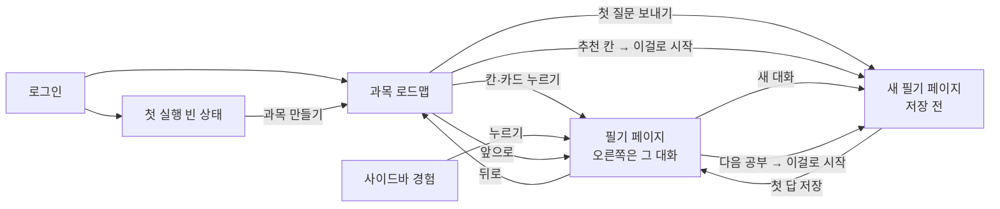
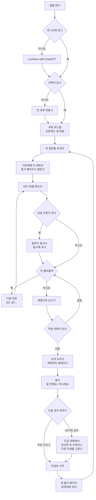
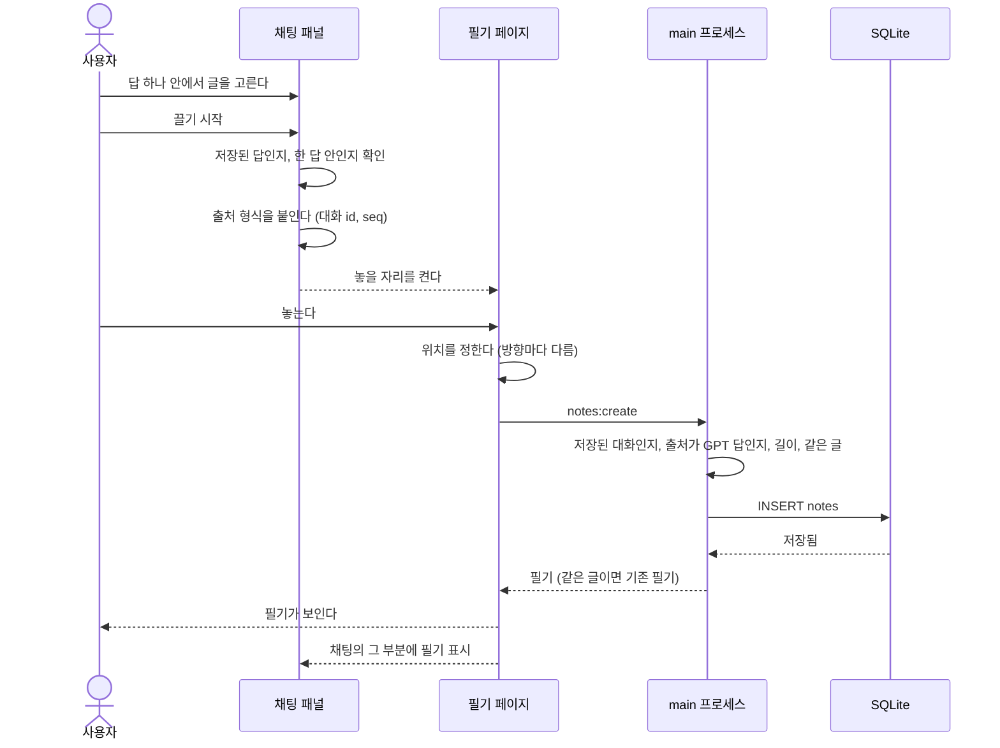
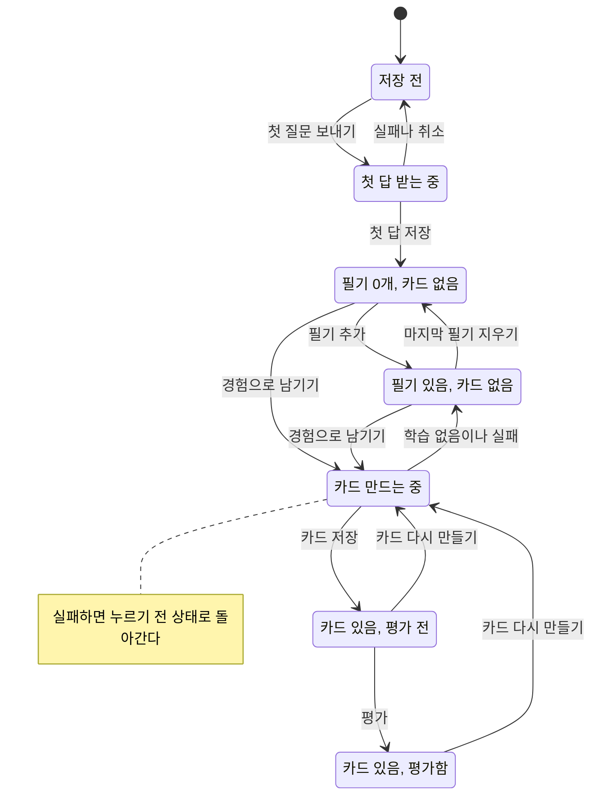
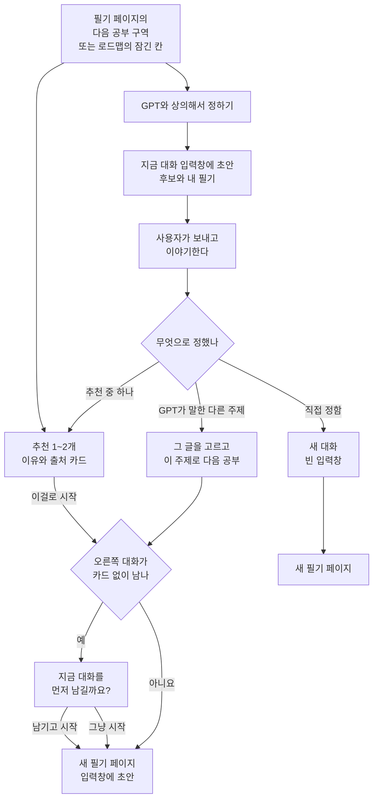
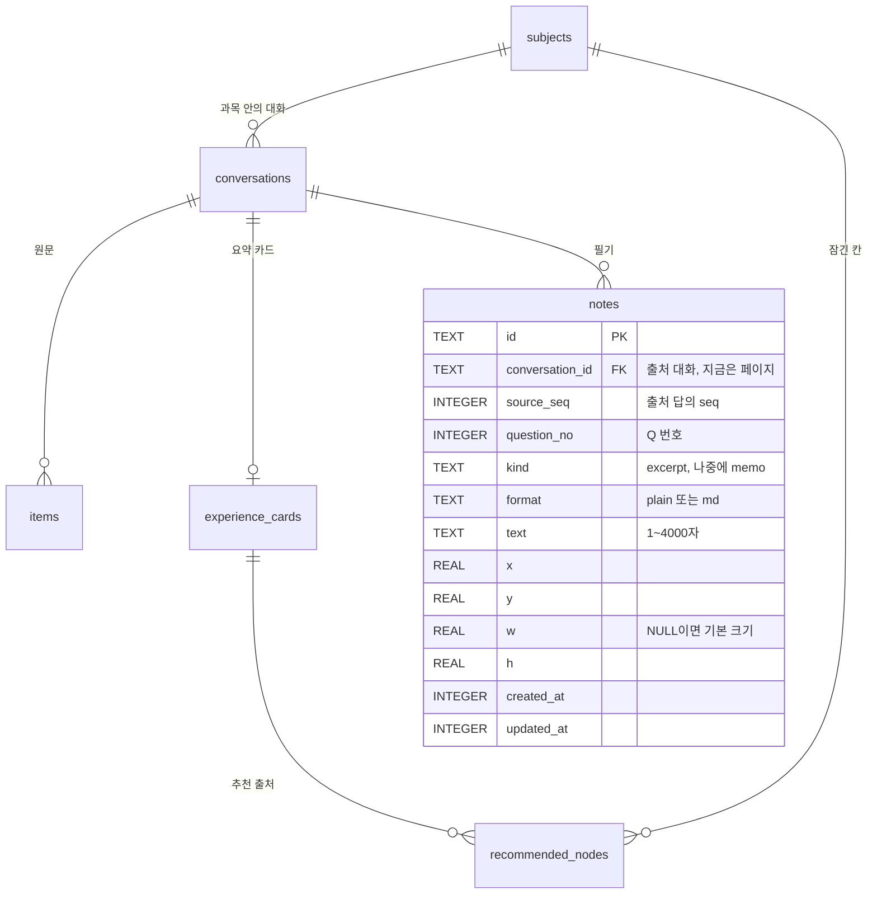
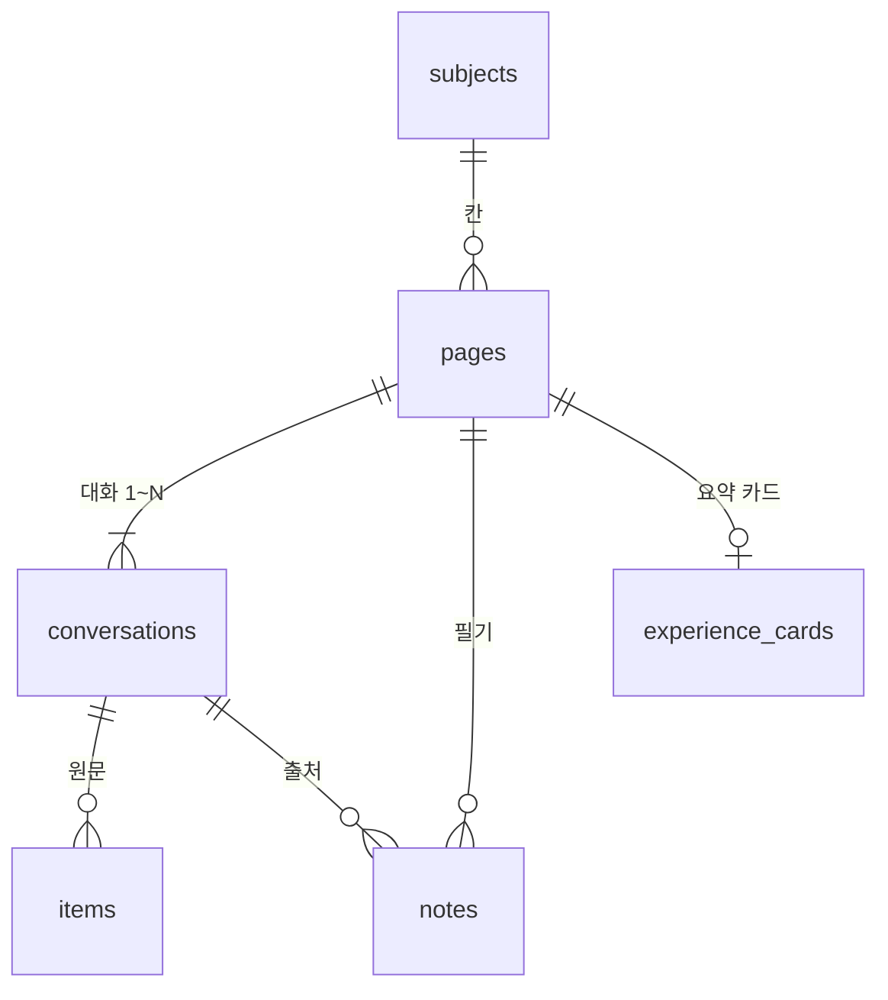
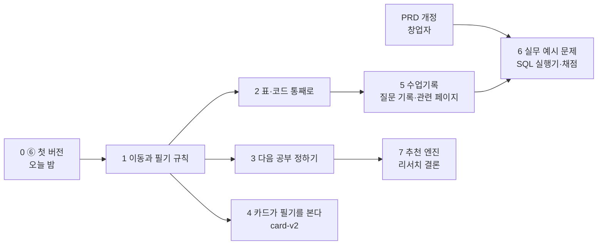

# 메인 화면 use flow v2: 필기 페이지와 다음 공부

> 2026-10-30 밤 설계서 세션(`night-flow`)이 썼다. 실행 계약은 브리프와 [밤 계획](ai.md)의 0·3.0·3.4장이다. 창업자가 아침에 읽고 다음 단계를 정하는 기준으로 쓴다.
>
> - **기준 문서:** [PRD 색인](../../../PRD.md) → [데스크톱 PRD](../../desktop/prd.md)(2026-10-30 개정: 루프 v2, FR-07·16·17), [TSD](../../desktop/tsd.md) 3장과 "D 화면 시안 결정", [밤 계획](ai.md) 3.6장(⑥에 이미 정해진 것).
> - **기준 코드:** `claude/desktop-night-docs`(`a4f7cbd` = main `b6e4ce5` + 문서). 오늘 밤 ③ ④ ⑤a ⑥의 코드는 아직 들어 있지 않다.
> - **필기 페이지 시안: 선택 대기.** 창업자가 A·B·C 중 하나를 고르면 1.6절과 5.2절을 그 안으로 좁힌다. 그 전까지 세 방향을 모두 적는다.
> - **이 문서가 정하지 않는 것:** 추천의 근거와 방법(같은 밤 리서치 보고서 `research-next-step.md`), 화면의 세부 모양(시안), 캔버스 라이브러리(시안 워크플로의 비교표).
>
> 창업자 원문: "경험카드를 클릭하면 이런 figma jam이 열려서 이 페이지에 gpt와의 대화를 필기할 수 있는 공간이 생겼으면 좋겠어." / "섹션1개 필기 N개 대화세션은 일단 1개로 세팅. 대화 세션을 추가하는 것은 추후업무로 넣자." 그리고 "Aside의 브라우저처럼" 여러 페이지를 오가는 느낌.

## 0. 한눈에 보기

### 핵심 정리

1. **가운데는 브라우저처럼 페이지를 바꿔 보여 준다.** 페이지는 과목 로드맵과 필기 페이지 두 종류다(대화 1개 = 필기 페이지 1개 = 칸 1개). 필기 페이지가 열려 있으면 오른쪽 대화는 늘 그 페이지의 대화다. 뒤로·앞으로는 Alt+←/→와 마우스 옆 버튼으로 한다.
2. **첫 질문을 보내는 순간 가운데가 그 대화의 새 필기 페이지로 바뀐다.** 첫 답이 오기 전에 놓을 자리가 생긴다. 로드맵에 끌어다 놓아도 그 페이지에 들어간다.
3. **필기는 저장된 GPT 답 하나 안에서 고른 글만 된다.** 원문 그대로, 출처(Q 번호와 시각)와 함께 남는다. 같은 글은 두 번 만들지 않고, 4,000자를 넘으면 나눠 달라고 한다. 지우면 [되돌리기]가 뜬다.
4. **경험 카드는 필기 페이지 맨 앞 "요약 자리"에 있다.** 만드는 동안 제목부터 채워지고, 평가 버튼은 펼치지 않아도 보인다. 카드가 필기를 읽게 바꾸는 일은 지시문 버전을 올려(`card-v2`) H2를 따로 잰다.
5. **다음 공부는 페이지 끝 "다음 공부" 구역에서 정한다.** 추천 칸 [이걸로 시작], 또는 [GPT와 상의해서 정하기](지금 대화 입력창에 후보와 내 필기를 담은 초안이 들어간다). 잠긴 칸은 막지 않는다.
6. **저장은 ⑥의 `notes` 표를 거의 그대로 쓴다.** `format`(고른 글 / 마크다운 블록) 열을 더하고 `kind`에는 CHECK를 걸지 않는다. "페이지 id = 대화 id"로 읽어 두면, 나중에 한 페이지에 대화 여러 개를 붙일 때 값을 옮기지 않고 `pages` 표를 만들 수 있다.

### 추천안 요약

| 질문 | 추천 | 이유 |
|---|---|---|
| 필기 페이지 시안 | **선택 대기.** 흐름만 보면 B, 또는 "A의 이동 + B의 기본 배치" | 창업자가 정한 "한 세션에서 질문 N개, 그 답을 필기"와 다시 보기에 가장 잘 맞고 구현 위험이 낮다(1.6) |
| 새 대화를 시작하면 가운데는 | 첫 질문을 보낼 때 새 필기 페이지로 간다 | 놓을 자리가 답보다 먼저 생긴다. 과목만 고른 상태에서는 로드맵(전체 개요)을 먼저 보여 준다 |
| 답 받는 중에 페이지를 바꾸면 | 1단계에서 "멈춤"을 "계속 받기"로 바꾼다 | 뒤로·탭이 생기면 옮겨 다니는 일이 잦다. 지금 멈춤 방식에는 질문이 다른 대화의 입력창으로 가는 순서 경쟁이 있다 |
| 무엇을 끌 수 있나 | 저장된 GPT 답 하나 안의 글. 표·코드는 손잡이로 통째로(마크다운 원문) | 출처(FR-16)가 분명하고, 표가 필기 안에서도 표로 보인다 |
| 바깥 앱에서 끌어 온 글 | 받지 않는다 | 출처가 없고, 카드의 "대화에 나온 사실만"(FR-08) 원칙과 어긋난다 |
| 필기 글 고치기 | 원문 필기는 고치지 않는다. 직접 쓰는 메모는 나중에 `memo` 종류로 | FR-16 "원문 그대로" |
| 카드가 필기를 읽게 할지 | 한다. 단 `card-v1.1` 평가 카드가 10장쯤 쌓인 뒤 `card-v2`로 | 필기는 사용자가 고른 핵심이라 카드를 더 정확하게 만들 수 있다. 표본을 나누지 않게 순서를 둔다 |
| GPT와 상의는 어느 대화에서 | 지금 대화에서. 입력창에 초안만 넣고 보내기는 사용자가 | 대화 맥락이 그대로 있다. 새 대화는 앞 공부를 모른다 |
| 잠금 해제 규칙 | 막지 않는다. 카드 없는 대화를 두고 다음 공부로 넘어갈 때 한 번 묻는다 | 스스로 고른 공부를 막으면 불편하다. 대신 카드를 남기게 이끌어 H2 표본을 늘린다 |
| 채점 방식 | 혼합: SQL은 결과셋 비교가 판정하고, GPT는 힌트와 설명만 | 판정이 매번 같고 사용량이 들지 않는다. GPT 채점은 같은 답에 다른 판정을 낼 수 있다 |
| 앱 안 SQL 실행 | 문제 기능과 함께 넣는다. 렌더러 Web Worker + sql.js, `'wasm-unsafe-eval'`은 그 워커 응답에만 | GPT가 만든 SQL을 파일에 닿지 않는 곳에서 돌린다. 오래 도는 쿼리는 워커를 끝내 바로 멈춘다 |
| 그래프 우선순위 | 결과 표 → 관련 페이지·개념 지도 → JOIN 행 짝짓기 그림 → 진도·약점 차트 | 이미 있는 데이터로 싸게 되는 것부터. 약점은 풀이 데이터가 쌓여야 믿을 수 있다 |
| 실무 예시 문제의 범위 | PRD 6장의 "현장 과제" 제외를 개정한 뒤, H2 2주 측정이 끝나고 | 지금 단계의 목표는 H2 검증이다 |

### 창업자가 정할 것

1. **필기 페이지 시안 A·B·C** (오늘 밤). 1.6절의 흐름 비교를 참고한다.
2. **실무 예시 문제를 언제 범위에 넣을지:** H2 측정 뒤 PRD 개정 **(추천)** / 지금 바로 개정.
3. **카드가 필기를 읽게 하는 시점:** `card-v1.1` 평가 카드 10장 뒤 **(추천)** / 바로 / 하지 않음.
4. **잠금 규칙:** 막지 않고 한 번 묻기 **(추천)** / 이전 칸에 카드가 있어야 열림 / 문제 N개를 풀어야 열림.
5. **답 받는 중 페이지 이동:** 계속 받기 **(추천)** / 지금처럼 멈춤.

---

## 1. 메인 화면 use flow

### 1.1 용어

| 말 | 뜻 |
|---|---|
| 페이지 | 가운데에 한 번에 하나 보이는 화면. 과목 로드맵과 필기 페이지 두 종류다 |
| 필기 페이지 | 대화 세션 하나의 공간. 요약 자리(경험 카드), 필기들, 다음 공부 구역이 있다. 로드맵의 칸 하나와 같다 |
| 저장 전 대화 | 첫 답이 아직 저장되지 않은 새 대화. DB 행이 없고 main 메모리에만 있다 |
| 출처 | 필기가 어느 대화의 몇 번째 답(`items.seq`)에서 왔는지, 그 답이 몇 번째 질문(Q1, Q2…)의 답인지 |
| 요약 자리 | 필기 페이지에서 경험 카드의 제목, 한 줄 요약, 면접 한 마디, 평가가 보이는 곳 |

### 1.2 화면 목록

| 화면 | 가운데 | 오른쪽 | 여기로 오는 길 |
|---|---|---|---|
| 로그인, Plus·Pro 필요 | 로그인 카드(지금과 같음) | 없음 | 로그아웃, 로그인 만료 |
| 첫 실행 빈 상태 | "과목을 만들면 여기에 길이 생겨요" [첫 과목 만들기] | 입력 비활성 | 과목 0개 |
| 과목 로드맵 | 고정 막대와 길(완료·진행 중·추천 칸). 칸마다 필기 수 | 새 대화 또는 하던 대화 | 과목 고르기, 뒤로, (A) 로드맵 탭 |
| 새 필기 페이지(저장 전) | 빈 페이지. "첫 질문을 보내면 이 페이지가 저장돼요" | 새 대화. 추천에서 왔으면 입력창에 초안 | 첫 질문 보내기, [새 대화], [이걸로 시작] |
| 필기 페이지 | 요약 자리, 필기들, 다음 공부 구역 | 그 대화(이어서 묻기) | 칸·카드·사이드바 경험 누르기, 첫 답 저장, 앞으로 |
| 카드 전체 보기 | 필기 페이지 안에서 요약 자리가 펼쳐진다(STAR, 배운 개념, 다음 할 일) | 그대로 | 요약 자리의 [카드 전체 보기] |
| 대화 상자 | 새 과목, 카드 다시 만들기(지금과 같음), 지금 대화를 먼저 남길지(새로, 4.4) | | |

로드맵 안에서 카드를 그 자리에 펼치던 지금 동작(D 시안의 "카드 보기")은 필기 페이지의 요약 자리와 카드 전체 보기로 옮긴다. 칸을 누르면 언제나 페이지가 열린다(FR-07).

### 1.3 오가는 길



규칙:

1. **오른쪽 대화 = 가운데 페이지.** 가운데가 필기 페이지면 오른쪽은 그 페이지의 대화다. 한쪽을 바꾸면 다른 쪽도 따라 바뀐다. 가운데가 로드맵이면 오른쪽에는 하던 대화가 그대로 남는다.
2. **칸, 카드, 사이드바 경험을 누르면 그 필기 페이지가 열린다.** 오른쪽에는 그 대화가 열려서 바로 이어서 물을 수 있다(FR-07, 루프 5단계). 잠긴 칸은 지금처럼 말풍선(O1)을 띄우고, [이걸로 시작]을 누르면 새 필기 페이지가 열린다. 저장 전 페이지의 제목 자리에는 추천 칸 제목을 보여 준다.
3. **첫 질문을 보내는 순간 가운데가 그 대화의 새 필기 페이지로 간다.** 이미 그 페이지면 그대로다. 첫 답이 오기 전에 놓을 자리가 보이게 하려는 것이다. 로드맵을 보면서 묻고 싶으면 뒤로 가면 되고, 그때도 로드맵에 놓으면 필기가 된다(2.2).
4. **[새 대화]:** 가운데가 필기 페이지면 새 필기 페이지로 바꾼다(규칙 1). 로드맵이면 그대로 둔다.
5. **과목 바꾸기:** 다른 과목을 고르면 그 과목 로드맵과 새 대화가 열린다(지금과 같다). 지금 과목을 다시 누르면 로드맵만 보여 주고 오른쪽 대화는 그대로 둔다. 지금 코드는 같은 과목을 눌러도 새 대화를 시작해서([App.tsx:117-128](../../../apps/desktop/src/renderer/App.tsx#L117-L128)) 하던 대화가 오른쪽에서 사라진다.
6. **뒤로·앞으로:** 본 순서를 메모리에 쌓는다. 항목은 `{kind:'roadmap', subjectId, conversationId}`(그때 오른쪽에 있던 대화) 또는 `{kind:'page', id}`이고, 돌아가면 그 과목 선택과 오른쪽 대화까지 되살린다. 뒤로 간 뒤 다른 페이지를 열면 앞쪽 기록은 지운다(브라우저와 같다). 50개까지 둔다. 단축키는 Alt+←/→, 마우스 옆 버튼, 가운데 머리의 ← → 버튼이다.
7. **다시 켤 때:** 마지막으로 본 과목의 로드맵으로 연다. 지금은 첫 과목을 연다(`App.tsx`의 `enterApp`). A안이면 열려 있던 탭도 되살린다(localStorage, 이 PC의 보기 편의).
8. **답 받는 중에 다른 페이지로 가면:** 지금은 스트림을 멈춘다(TSD 3.8). 1단계에서 "답은 계속 받고, 끝나면 그 대화에 저장한다"로 바꾸기를 추천한다. 동시에 받는 답은 지금처럼 하나뿐이다. 지금 코드는 멈출 때 보낸 질문을 입력창에 되돌리는데, 그 사이 다른 대화를 열었으면 질문이 그 대화의 입력창으로 들어갈 수 있다([App.tsx:94-100](../../../apps/desktop/src/renderer/App.tsx#L94-L100)과 [App.tsx:422-430](../../../apps/desktop/src/renderer/App.tsx#L422-L430)의 순서 경쟁). 바꿀 때 함께 고친다.
9. **네트워크가 없어도** 로드맵, 필기 페이지, 필기 만들기·옮기기·지우기는 된다. 모두 이 PC의 SQLite만 쓴다. 대화와 카드 만들기만 네트워크가 필요하다.

### 1.4 첫 실행부터 다음 공부까지



### 1.5 상태별 화면

| 상태 | 가운데 | 오른쪽 | 문구 | 할 수 있는 일 |
|---|---|---|---|---|
| 과목 없음 | 빈 길 그림 | 입력 비활성 | "과목을 만들면 여기에 길이 생겨요" / "대화는 늘 과목 안에서 시작해요"(지금과 같음) | [첫 과목 만들기] |
| 과목은 있고 대화 없음 | 빈 로드맵 | 새 대화 | "오른쪽에서 첫 대화를 시작해 보세요" + "질문을 보내면 가운데에 필기 페이지가 열려요" | 질문 보내기 |
| 저장 전 페이지 | 빈 페이지 | 새 대화 | "첫 질문을 보내면 이 페이지가 저장돼요" | 질문 보내기, 뒤로 |
| 첫 답 받는 중 | 빈 페이지 | 흘러나오는 답 | 답을 끌려고 하면 "답이 끝나면 필기할 수 있어요" | 멈추기 |
| 첫 답 실패·취소 | 저장 전 페이지 그대로 | 오류 배너(지금과 같음), 질문은 입력창에 | | [다시 보내기] 등 |
| 필기 0개 | 요약 자리(카드 없음) + 안내 | 그 대화 | "GPT 답에서 남기고 싶은 부분을 골라 여기로 끌어 오세요. 글을 고르면 [필기에 추가]도 떠요" | 끌기, [필기에 추가] |
| 필기 있음, 카드 없음 | 필기들 + 요약 자리 안내 | 그 대화 | "경험으로 남기면 여기에 이 대화의 요약이 생겨요" | [경험으로 남기기] |
| 카드 만드는 중 | 요약 자리에 제목 → 한 줄 요약 → 면접 한 마디가 차례로(FR-15) | 대화 계속 가능 | "카드 만드는 중…" | [취소](지금과 같음) |
| 학습 없음 | 요약 자리는 카드 없음 상태로 돌아감 | 배너(지금과 같음) | "카드로 남길 학습 내용이 없어요" | [계속 대화하기] |
| 카드 실패 | 요약 자리는 누르기 전 상태로 | 배너(지금과 같음: 형식 오류, 2분 초과, 사용량 한도, 로그인 만료) | | [다시 만들기] |
| 카드 있음, 평가 전 | 요약 자리: 제목, 한 줄 요약, 면접 한 마디, 평가 버튼 | 그 대화 | 로드맵 칸 칩 "평가 전" | 평가, [카드 전체 보기] |
| 카드 있음, 평가함 | 고른 평가 버튼이 눌린 모양 | 그 대화 | | 평가 바꾸기 |
| 카드 뒤에 더 공부함 | 요약 자리 아래 한 줄 | 그 대화 | "카드를 만든 뒤 2턴 더 공부했어요" | [카드 다시 만들기] |
| 필기 저장 실패 | 놓은 필기를 거둔다 | | "필기를 저장하지 못했어요" | [다시 시도] |
| 필기 4,000자 초과 | 필기가 생기지 않는다 | | "필기는 4,000자까지예요. 꼭 남길 부분만 골라 주세요" | |
| 같은 글을 또 끎 | 원래 필기로 옮겨 가 잠깐 강조 | | "이미 필기한 부분이에요" | |
| 로그인 만료·사용량 한도 | 페이지는 그대로, 필기도 된다 | 배너(지금과 같음) | | [다시 로그인], [Manage usage] |

알림(위 표의 필기 관련 문구)은 가운데 아래쪽에 잠깐 떴다 사라지는 한 줄로 보여 준다. 대화·카드 오류는 지금처럼 채팅 입력창 위 배너다.

### 1.6 세 방향별 차이 (선택 대기)

시안 워크플로가 세 방향에 준 축을 기준으로, 이 문서의 흐름이 각 방향에서 어떻게 되는지 적는다.

| | A 탭 브라우저 + 자유 캔버스 | B 질문별 정리 보드 | C 길 위에서 확대 |
|---|---|---|---|
| 페이지를 여는 모양 | 가운데 머리에 탭 [로드맵] [페이지 ×] [+]와 ← → | 경로 표시 "SQLD 길 › 제목"과 ← | 칸 쪽으로 확대되고 칸 둘레에 필기 섬이 펼쳐진다 |
| 뒤로 | 본 순서대로. 탭 하나에 페이지가 하나라 탭마다 기록을 따로 두지 않는다 | 로드맵으로 | 축소(길 전체) |
| 놓는 자리 | 놓은 곳 그대로 | 출처 질문 줄의 끝("Q2 줄에 들어가요"). 놓은 위치는 쓰지 않는다 | 칸 둘레 빈자리 |
| [필기에 추가]의 자동 위치 | 질문별 세로 열(Q1 열, Q2 열…)의 맨 아래 | 출처 질문 줄의 끝 | 섬의 다음 빈자리 |
| 요약 자리 | 왼쪽 위 고정 카드 | 맨 위 전체 폭 띠 | 칸 자체가 요약 |
| 다음 공부 자리 | 오른쪽 위 떠 있는 패널 | 맨 아래 구역 | 길 앞쪽 잠긴 칸이 섬 옆에서 근거와 함께 드러난다 |
| 저장할 위치 값 | x, y, w, h | 줄 안 순서 `ord` (x·y는 쓰지 않음) | 칸 중심 기준 상대 x, y |
| 다시 볼 때 | 내가 배치한 대로. 정리하지 않으면 어수선하다 | 질문 순서로 읽힌다. 복습과 면접 준비에 강하다 | 길 위 위치(언제 배운 것인지)가 함께 보인다 |
| 키보드로 옮기기 | 화살표 8px, Shift+화살표 40px | Alt+↑/↓로 줄 안 순서 | 화살표 |
| 구현(시안 워크플로의 캔버스 비교표) | React Flow(MIT, CSP 변경 없음)로 이동·확대·미니맵을 얻는다. 연결선·미니맵이 필요 없으면 직접 구현도 된다. tldraw는 패키지 앱에서 키 없이 멈춘다 | 직접(CSS grid·flex). 라이브러리가 필요 없다 | 직접. 지금 로드맵 DOM에 확대·이동(transform)을 붙인다. 칸 둘레 필기 배치와 겹침이 가장 어렵다 |
| 위험 | 확대·이동·겹침·접근성을 모두 다뤄야 한다 | "FigJam 같다"는 느낌이 약하다 | 칸이 늘면 섬이 겹친다. 1280 폭에서 가운데가 약 650px라 좁다 |

A안의 탭 세부: 로드맵 탭은 닫을 수 없게 고정하고, 페이지 탭은 8개까지 둔다(넘으면 가장 오래 안 본 탭을 닫는다). Ctrl+Tab 다음 탭, 가운데 클릭 닫기. [+]는 [새 대화]와 같다. 탭 닫기를 Ctrl+W로 하려면 먼저 메뉴를 손봐야 한다. 앱은 Electron 기본 메뉴를 숨기기만 하고 그대로 두는데(`main.ts:58`의 `autoHideMenuBar`), 기본 메뉴의 Ctrl+W는 창을 닫아 앱이 꺼진다.

**흐름 관점 의견** (선택은 창업자가 한다):

- **B**가 이 문서의 흐름과 가장 잘 맞는다. 창업자가 정한 단위("한 세션에서 질문 N개, 그 답을 필기")가 그대로 화면 구조가 되고, 다시 볼 때 질문 순서로 읽혀 면접 준비("이 질문에 이렇게 답할 수 있다")로 이어진다. 놓는 위치를 고민할 필요가 없어 공부 흐름이 끊기지 않는다. 캔버스 라이브러리가 필요 없어 CSP·라이선스 위험도 없다. 약점은 "FigJam 같은 필기 공간"이라는 느낌이 약하다는 것이다.
- **A**는 창업자가 말한 두 그림(FigJam, Aside 브라우저)에 가장 가깝다. 자유 배치는 정리하는 사람에게는 좋지만, 정리하지 않으면 다시 볼 때 어수선하다. [필기에 추가]의 기본 위치를 질문별 세로 열로 두면(위 표) 이 약점이 줄어든다.
- **C**는 길과 필기를 한 화면에 두는 새로운 그림이지만, 칸이 늘면 섬이 겹치고 구현 위험이 가장 크다.
- 섞는다면 "A의 탭과 뒤로·앞으로 + 캔버스 안 기본 배치는 B의 질문 열"이 두 장점을 함께 얻는다. 섞으면 섞은 시안을 다시 띄워 확인받는다(`.claude/rules/ui-change.md`).

---

## 2. 드래그 → 필기 규칙

### 2.1 끌 수 있는 것

| 무엇 | 되나 | 저장되는 글 |
|---|---|---|
| 저장된 GPT 답 안에서 고른 글(일부) | 된다 | 고른 글의 `text/plain` 그대로. 양 끝 공백을 지우고 줄바꿈 문자만 LF로 맞춘다. `format='plain'` |
| GPT 답의 표, 코드 블록 통째로 | 된다. 블록에 마우스를 올리면 왼쪽에 뜨는 끌기 손잡이를 끈다(2단계) | 그 블록의 마크다운 원문. 필기 안에서 표·코드로 다시 그린다. `format='md'` |
| 답 하나 통째로 | 된다. 답 머리의 [필기에 추가 ▾]에서 "답 전체"(2단계) | 마크다운 원문. 4,000자를 넘으면 막는다 |
| 두 답에 걸친 선택 | 안 된다 | 놓을 자리가 켜지지 않고 "한 답 안에서만 골라 주세요" |
| 흘러나오는 중인 답 | 안 된다 | "답이 끝나면 필기할 수 있어요" |
| 내 질문 | 안 된다 | 질문은 출처 표시(Q1, Q2…)로 이미 남는다 |
| 다른 앱의 글, 파일, 이미지 | 안 된다 | 놓을 자리가 켜지지 않는다. 파일을 놓아도 아무 일이 없게 `dragover`·`drop`의 기본 동작을 막는다 |

손잡이 방식이 필요한 이유: 표를 마우스로 고르면 칸 사이가 탭 문자로 바뀐 글이 되고, 코드 블록의 언어 표시도 사라진다. 블록 단위로 마크다운 원문을 남기면 ⑤a가 만드는 표·코드 표시를 필기에서도 그대로 쓸 수 있다. react-markdown은 블록마다 원문 위치(`node.position`)를 주므로 원문을 정확히 잘라 낼 수 있다.

### 2.2 놓는 곳

- **필기 페이지 어디든.** 끄는 동안 가운데에 "여기에 놓으면 필기가 돼요"가 뜬다. A는 놓은 자리에, B는 출처 질문 줄 끝에, C는 칸 둘레 빈자리에 놓인다(1.6).
- **로드맵.** "여기에 놓으면 ‘제목’ 필기 페이지에 남아요"가 뜬다. 놓으면 오른쪽 대화의 페이지에 자동 위치로 넣고 그 페이지를 연다(뒤로·앞으로 기록에 쌓인다).
- **사이드바와 오른쪽 패널 안**에는 놓을 수 없다.
- **놓을 자리를 켜는 조건:** 끄는 데이터에 Experii 출처 형식 `application/x-experii-note`(대화 id와 답의 `seq`)가 있을 때만 켠다. 끄는 도중에는 데이터 내용은 못 읽고 형식 이름만 볼 수 있으므로 형식 이름으로 판단한다. 채팅 패널이 `dragstart`에서 고른 글의 위치를 보고 이 형식을 붙인다.
- Esc를 누르거나 바깥에 놓으면 아무 일도 없다.

### 2.3 저장 전 대화에서 끌 때

저장 전 대화에는 끌 수 있는 답이 없다. 첫 답은 흘러나오는 동안 끌 수 없고, 다 받으면 그 순간 대화가 저장된다(main은 저장한 뒤에 `done`을 보낸다, [chat.ts:120-126](../../../apps/desktop/src/main/chat.ts#L120-L126)). 그래서 화면에 보이는 다 받은 답은 언제나 저장된 답이다. 그래도 순서가 꼬이는 경우에 대비해 main은 저장 전 대화의 `notes:create`를 `not_saved`로 거절하고, 화면은 "첫 답을 받은 뒤 필기할 수 있어요"를 띄운다(ai.md 3.6).

### 2.4 같은 글을 두 번 끌면

- 같은 대화, 같은 답(`source_seq`), 공백을 맞춘 글이 같은 필기가 이미 있으면 새로 만들지 않는다. main이 기존 필기를 돌려주고(`duplicate: true`), 화면은 그 필기로 옮겨 가 잠깐 강조한 뒤 "이미 필기한 부분이에요"를 띄운다.
- 일부만 겹치는 글(더 길게 또는 짧게 고른 글)은 새 필기로 만든다. 다르게 고른 데는 이유가 있다고 본다.
- 채팅에서는 이미 필기한 부분에 옅은 파랑 바탕을 깐다(디자인 규칙의 "경험이 쌓이는 자리"). CSS Custom Highlight API(`::highlight`)를 쓰면 DOM을 바꾸지 않고 지금 CSP(`style-src 'self'`) 안에서 된다. 필기 글을 답에서 찾지 못하면 표시만 빼고 필기는 그대로 둔다.

### 2.5 긴 글

- 4,000자까지 한 필기가 된다(ai.md 3.6). 넘으면 만들지 않고 "필기는 4,000자까지예요. 꼭 남길 부분만 골라 주세요"를 띄운다. 잘라서 넣지 않는다. 원문 그대로라는 약속(FR-16)이 깨지고, 남길 부분을 고르는 일 자체가 공부의 일부이기 때문이다.
- 페이지에서는 8줄이 넘는 필기를 접어 보여 주고 [더 보기]로 편다. 필기 폭은 기본 288px 안팎이고 방향마다 맞춘다.

### 2.6 옮기기, 지우기, 되돌리기

- **옮기기:** 필기의 머리를 포인터로 끈다. 채팅에서 페이지로 끄는 HTML5 끌기와 다른 장치(pointer 이벤트)다. 놓을 때 한 번만 저장한다(`notes:update {id, x, y}`). A·C는 자유 위치, B는 줄 안 순서만 바뀐다.
- **지우기:** 필기에 마우스를 올리거나 포커스하면 보이는 ×, 또는 Delete 키. 확인 대화 없이 바로 지우고 "필기를 지웠어요 [되돌리기]"를 8초 동안 띄운다.
- **되돌리기:** [되돌리기]는 지운 필기를 같은 글·출처·위치로 다시 만든다. 1단계에서 Ctrl+Z / Ctrl+Shift+Z를 더한다(만들기, 옮기기, 지우기). 기록은 페이지마다 따로 두고 페이지를 떠나면 비운다. 포커스가 입력창에 있으면 입력창의 되돌리기가 먼저다.
- ⑥ 첫 버전에는 옮기기와 지우기만 있다(ai.md 3.6). `notes:delete`가 지운 행을 돌려주게 해 두면 1단계의 되돌리기가 쉬워진다.

### 2.7 키보드 대안

| 키 | 동작 | 어디서 |
|---|---|---|
| (글을 고르면 뜨는) [필기에 추가] | 고른 글을 자동 위치에 필기로 | 채팅(⑥) |
| Ctrl+Shift+N | 위와 같음 | 채팅에서 글을 골랐을 때 |
| Tab → 답 머리의 [필기에 추가 ▾] | 그 답의 블록 목록(문단·목록·표·코드, 앞 40자)과 "답 전체" 중에서 골라 필기로 | 채팅(2단계, 키보드만 쓰는 사람용) |
| Delete | 포커스한 필기 지우기(되돌리기 가능) | 필기 페이지 |
| 화살표, Shift+화살표 / Alt+↑↓ | 필기 옮기기 / B안의 줄 안 순서 | 필기 페이지 |
| Ctrl+Z, Ctrl+Shift+Z | 되돌리기, 다시 하기 | 필기 페이지, 입력창 밖(1단계) |
| Alt+←, Alt+→ | 뒤로, 앞으로 | 어디서나(1단계) |
| Esc | 끌기 취소, 펼친 카드 접기 | |

필기의 Tab 순서는 읽는 순서다(A·C는 위에서 아래, 왼쪽에서 오른쪽, B는 질문 줄 순서). 놓은 결과는 화면 읽기 프로그램에 `aria-live`로 알린다("필기를 남겼어요, Q2"). 한 글자 단축키는 쓰지 않는다.

### 2.8 처리 순서



### 2.9 보안과 데이터 경계

- 끈 데이터의 `text/html`은 쓰지 않는다. 필기는 글자(plain)나 마크다운만 저장하고, 마크다운은 채팅과 같은 컴포넌트(원시 HTML 끔, 링크는 글자)로 그린다. `dangerouslySetInnerHTML` 금지 테스트(TSD 3.3)는 그대로 지킨다.
- main은 `notes:create`에서 출처를 다시 확인한다: 그 대화에 그 `seq`의 assistant 메시지가 있는지. `question_no`는 화면이 보낸 값을 믿지 않고 main이 `seq`로 계산한다.
- 필기만 따로 OpenAI로 보내지 않는다. 4장의 "GPT와 상의" 초안처럼 사용자가 보내기를 눌러야 대화로 들어간다. 나중에 카드가 필기를 읽게 하면(7장 4단계) 카드 요청에 "어디를 필기했는지"가 함께 간다. 필기는 원래 대화에서 나온 글이라 새로운 내용이 나가는 것은 아니지만, 그때 PRD 8장에 한 줄을 더한다.

---

## 3. 필기 페이지와 경험 카드

### 3.1 요약 자리

- 카드는 페이지의 첫 화면에 있다: A는 왼쪽 위 고정 카드, B는 맨 위 전체 폭 띠, C는 칸 자체.
- 보이는 것(FR-17): 제목, 한 줄 요약, 면접 한 마디, 평가 버튼 두 개, 그리고 [카드 전체 보기]. 가림 알림(FR-08)이 있으면 한 줄로 함께 보인다.
- [카드 전체 보기]는 그 자리에서 펼친다(D 시안의 "모달 아님"). 내용과 순서는 지금 [CardView.tsx](../../../apps/desktop/src/renderer/CardView.tsx)와 같다. 다만 바닥줄의 [대화 다시 열기]는 필요 없어진다(오른쪽에 이미 열려 있다). 그 자리는 [이어서 묻기](입력창으로 포커스)로 바꾼다.

### 3.2 카드 만들기 전, 중, 후



- **전:** 요약 자리에 "경험으로 남기면 여기에 이 대화의 요약이 생겨요"와 테두리 버튼 [경험으로 남기기]를 둔다. 채팅 머리의 주 버튼과 같은 동작이고 상태도 함께 바뀐다(만드는 중이면 둘 다 잠긴다). 색을 채운 버튼은 채팅 머리의 것 하나만 둔다(디자인 규칙).
- **중:** 누르면 요약 자리가 바로 "만드는 중"으로 바뀌고(FR-15), ④의 `cards:event`로 제목 → 한 줄 요약 → 면접 한 마디가 차례로 채워진다. 그동안 대화는 계속할 수 있다. 다른 페이지로 가도 만들기는 계속되고, 사이드바와 로드맵 칸에 "만드는 중"이 보인다(지금과 같다).
- **후:** 평가 버튼이 바로 보인다. 카드가 버튼을 누른 때까지의 대화로 만들어졌다는 것(ai.md 3.2의 4번)을 요약 자리에 작은 글로 남긴다: "10월 30일 오후 9:12까지의 대화로 만들었어요".
- **카드 뒤에 더 공부하면:** "카드를 만든 뒤 2턴 더 공부했어요 [카드 다시 만들기]"를 한 줄로 띄운다. 정확히 세려면 카드에 "읽은 마지막 `seq`"(`experience_cards.input_seq`)를 저장하고, 그 뒤의 user 메시지 수를 센다. 카드가 끝난 시각(`updated_at`)으로 세면 만드는 동안 보낸 질문을 놓친다.

### 3.3 다시 만들기

- [카드 다시 만들기]는 카드 전체 보기의 바닥줄과 3.2의 "카드 뒤에 더 공부하면" 줄에 있다.
- 확인 대화는 지금 것을 그대로 쓴다: 평가가 지워지고, 최신 대화면 추천 칸도 바뀐다([db.ts:270-334](../../../apps/desktop/src/main/db.ts#L270-L334)).
- 필기는 다시 만들어도 그대로다. 카드와 필기는 따로 저장된다.

### 3.4 평가와 H2

H2는 `prompt_version`별로 "평가한 카드 중 면접에 쓸 만해요 비율"을 잰다([h2.mjs:38](../../../apps/desktop/scripts/h2.mjs#L38)). 필기 페이지가 들어와도 측정이 끊기지 않게 다음을 지킨다.

1. 평가 버튼은 요약 자리에 늘 보인다. 펼치지 않아도 된다. 카드가 생기는 순간 그 자리에 있으므로, 지금(로드맵에서 카드가 자동으로 펼쳐진다)과 평가하는 때가 같다.
2. 평가는 로드맵 칸 칩, 사이드바 점, 고정 막대의 "쓸 만해요 y/평가한 수"와 "평가 전 n"에 바로 반영된다(지금과 같다).
3. 카드 입력(지시문이나 넣는 데이터)이 바뀌면 `prompt_version`을 올린다. 오늘 밤 ④가 `card-v1.1`로 올린다. 카드가 필기를 읽게 하면 `card-v2`다.
4. 화면만 바뀌면 버전을 올리지 않는다. 다만 `card-v1`과 `card-v1.1`의 차이에는 화면 변화(필기 페이지)도 섞여 있다는 것을 밤 보고와 H2 기록에 적는다.
5. 다시 만들면 평가가 지워진다(지금과 같다). 확인 대화에 적혀 있다.
6. (선택) 고정 막대의 "평가 전 n"을 누르면 가장 오래된 평가 전 페이지로 간다. 평가를 모으는 데 돕는다.

---

## 4. 다음 공부 정하기

추천을 무엇으로 만들지(근거와 방법)는 리서치 보고서가 다룬다. 여기서는 화면 흐름과 추천에 넘길 데이터만 정한다. 지금 추천은 카드를 만들 때 GPT가 고르는 1~2개(`recommended_next`)이고, 과목의 최신 대화 카드에서 나온 것만 잠긴 칸이 된다([db.ts:314-331](../../../apps/desktop/src/main/db.ts#L314-L331)).

### 4.1 흐름



### 4.2 추천 칸 고르기

- **로드맵:** 잠긴 칸 → 말풍선(O1) → [이걸로 시작] → 새 필기 페이지와 입력창 초안(`chat.ts`의 `draftFor`). 지금과 같고, 가운데가 새 페이지로 간다는 것만 다르다.
- **필기 페이지의 "다음 공부" 구역:** 이 과목의 지금 추천(잠긴 칸과 같은 것)을 이유와 출처("‘LEFT JOIN과 NULL’ 카드에서 나온 추천")와 함께 보여 주고 [이걸로 시작]을 둔다. 오래된 페이지에서도 같은 목록을 보여 준다. 오래된 카드의 추천은 새 카드가 생길 때 지워지기 때문이다.
- **카드가 아직 없는 과목:** "경험으로 남기면 다음 공부 추천이 생겨요".

### 4.3 GPT와 상의하기

- [GPT와 상의해서 정하기]는 **지금 대화**의 입력창에 초안을 넣는다. 보내기는 사용자가 누른다(O1과 같은 원칙).
- 초안 예:

  ```text
  다음에 뭘 공부하면 좋을지 내 필기를 보고 같이 정해 줘.
  추천 후보: ① 외부 조인과 NULL 함수 ② 집합 연산자
  내가 필기한 부분: “LEFT JOIN은 왼쪽 테이블의 행을 모두 남기고…”, “ON은 조인할 때 거르고…”
  ```

  후보는 지금 추천 1~2개, 필기는 최근 5개를 60자씩 넣는다. GPT는 대화 원문은 알지만 어디를 필기했는지는 모르므로 초안에 담는다.
- **정한 뒤:** 추천 중 하나면 [이걸로 시작]. GPT가 다른 주제를 말했으면 그 글을 고르고, 글을 고르면 뜨는 메뉴의 [이 주제로 다음 공부]를 누른다. 새 필기 페이지가 열리고 입력창에 "‘고른 글’을(를) 공부하고 싶어요."가 들어간다. 직접 정하면 [새 대화].
- **상의한 턴은 그 대화에 남는다.** 카드를 다시 만들면 이 턴도 읽는다. 학습이 아닌 말은 지시문 규칙 4가 거르고, `recommended_next`에는 오히려 상의 결과가 반영될 수 있다.
- **새 대화에서 상의하지 않는 이유:** 새 대화는 앞 공부를 모르고, 첫 메시지가 페이지 제목이 되어 "다음에 뭘 공부하면…" 같은 제목이 생긴다(`chat.ts`의 `titleFrom`).
- **나중:** ③의 도구가 실계정에서 되면 "이 페이지 필기 읽기" 도구를 더한다. 그러면 초안에 필기를 넣지 않아도 GPT가 필요할 때 읽는다.

### 4.4 지금 대화를 먼저 남길지 한 번 묻기

- **언제:** [이걸로 시작]이나 [이 주제로 다음 공부]를 누를 때, 오른쪽 대화가 저장됐고 카드가 없으면.
- **문구:** "지금 대화를 먼저 경험으로 남길까요?" / "‘제목’ 대화에 아직 카드가 없어요. 남기면 면접에 쓸 만한지 평가할 수 있어요." [남기고 시작] [그냥 시작]
- [남기고 시작]은 카드 만들기를 시작하고 곧바로 새 페이지로 간다. 카드는 뒤에서 만들어진다(FR-15).
- 같은 대화에 대해서는 한 번만 묻는다. 채팅 머리의 [새 대화]에서는 묻지 않는다(자주 쓰는 버튼이라).

### 4.5 추천에 넘길 데이터

| 데이터 | 어디 있나 | 지금 있나 |
|---|---|---|
| 필기 | `notes`: 글, 출처 질문, 만든 시각, 페이지별 개수 | ⑥부터 |
| 질문 | `items`(user 메시지): 글, 시각, 순서 | 있다 |
| 카드 | `experience_cards`: 제목, 한 줄 요약, 배운 개념(8개 이하), 다음 할 일, 만든·고친 시각, 지시문 버전 | 있다 |
| 추천과 그 선택 | `recommended_nodes`(지금 것만), `conversations.from_recommended_node_id`(시작한 추천) | 일부. 새 카드가 생기면 지난 추천은 지워진다. "추천했지만 고르지 않은 것"이 필요하면 지우지 않고 남기도록 바꾼다 |
| 평가 | `useful`, `rated_at` | 있다 |
| 다시 본 기록 | 페이지를 연 시각 | 없다. 리서치가 간격 반복을 권하면 `page_views(conversation_id, opened_at)` 같은 표가 필요하다 |
| 풀이 결과 | 문제, 답, 판정, 힌트 수 | 없다(6.4) |
| 개념 이름 정리 | 같은 개념을 같은 이름으로 | 없다. "COUNT(*)"와 "COUNT 함수"는 다른 글자다 |

---

## 5. 저장 구조 제안

### 5.1 `notes` 표 (ai.md 3.6 초안 검토)

```sql
-- 마이그레이션 2. 적용 전 VACUUM INTO 백업(지금 규칙)
CREATE TABLE notes (
  id TEXT PRIMARY KEY,
  conversation_id TEXT NOT NULL REFERENCES conversations(id) ON DELETE CASCADE,
  source_seq INTEGER,
  question_no INTEGER,
  kind TEXT NOT NULL DEFAULT 'excerpt',
  format TEXT NOT NULL DEFAULT 'plain',
  text TEXT NOT NULL CHECK (length(text) BETWEEN 1 AND 4000),
  x REAL NOT NULL DEFAULT 0,
  y REAL NOT NULL DEFAULT 0,
  w REAL,
  h REAL,
  created_at INTEGER NOT NULL,
  updated_at INTEGER NOT NULL
);
CREATE INDEX notes_conversation ON notes(conversation_id, created_at);
```

| 열 | 3.6 초안 | 검토 | 제안 |
|---|---|---|---|
| `id` | 있음 | 다른 표와 같은 uuid | 그대로 |
| `conversation_id` | → conversations CASCADE | 뜻을 "출처 대화"로 읽는다. 지금은 페이지 id와 값이 같다(5.3) | 그대로 |
| `source_seq` | 있음 | 출처 assistant 메시지 item의 `seq` | NULL 허용. `excerpt`면 zod에서 필수. 나중 `memo`는 NULL |
| `question_no` | 있음 | `items`는 덧붙이기만 하므로 저장해 둬도 어긋나지 않는다 | 그대로. main이 `seq`로 계산해 넣는다 |
| `text` | 1~4000자 | 원문 | `excerpt`는 고치지 않는다. `notes:update`의 `text`는 나중 `memo`에만 받는다 |
| `x, y, w, h` | 있음 | A·C에 맞는다. B는 줄 안 순서가 필요하다(5.2) | REAL. `w, h`가 NULL이면 기본 크기 |
| `kind` | 기본 `excerpt` | 나중에 `memo`(직접 쓴 메모), `refined`(GPT가 다듬은 필기)가 생긴다 | CHECK를 걸지 않고 zod로 검사한다. SQLite는 CHECK를 바꾸려면 표를 다시 만들어야 한다 |
| `format` | 없음 | 표·코드 블록을 통째로 끌면 마크다운 원문을 남겨야 다시 표로 그린다 | **더한다.** `plain` 또는 `md`. ⑥에 없으면 마이그레이션 3에서 `ADD COLUMN ... DEFAULT 'plain'` |
| `created_at, updated_at` | 있음 | `updated_at` 순으로 그리면 마지막에 옮긴 필기가 위로 온다. A의 겹침 순서를 열 없이 얻는다 | 그대로 |
| 인덱스 | `conversation_id` | 목록은 만든 순서로 읽는다 | `(conversation_id, created_at)` |

IPC 검토:

- `notes:list {conversationId}` → 만든 순서의 필기 목록.
- `notes:create {conversationId, sourceSeq, text, format, x, y}` → `{note, duplicate}`. 위치는 화면이 정해서 보낸다(자동 위치가 방향마다 다르다).
- `notes:update {id, x?, y?, w?, h?}`. `excerpt`의 글을 바꾸려 하면 `not_editable`.
- `notes:delete {id}` → 지운 행(되돌리기용).
- 오류 코드: `not_saved`, `not_found`, `too_long`, `invalid_source`, `not_editable`.
- `roadmap:get`의 칸과 사이드바 경험에 필기 수 `notes`를 더한다(칸에 "필기 3"을 보여 주려고).
- 채널 4개를 더하면 `api.ts`, `preload.ts`, `ipc.ts`를 함께 고친다. e2e가 노출 API 목록을 정확히 비교한다(ai.md 2장).

### 5.2 방향별 차이

- **A:** 위 그대로. 보던 위치와 확대 배율은 페이지마다 localStorage `experii.canvas.v1`에 둔다. DB에 넣지 않는다(이 PC의 보기 편의).
- **B:** `ord REAL`(줄 안 순서)을 더하고 x·y는 0으로 둔다. 순서는 분수 값으로 둔다: 두 필기 사이에 넣으면 두 값의 가운데 값을 줘서 다른 필기를 고쳐 쓰지 않는다. 줄은 `question_no`로 묶는다.
- **C:** x·y를 칸 중심 기준 상대 좌표로 둔다. 칸 위치는 길 배치에서 계산되고 칸이 늘면 움직이므로, 절대 좌표를 저장하면 어긋난다.

### 5.3 "한 페이지에 대화 여러 개"를 막지 않는 모양

지금은 대화 1개 = 페이지 1개다(창업자 결정). 나중에 붙일 때 값을 옮기지 않으려면 지금 다음을 지킨다.

1. `notes.conversation_id`는 "출처 대화"다. 페이지 소속은 지금 그 값과 같다.
2. 렌더러 상태와 뒤로·앞으로 기록은 `{kind:'page', id}`로 둔다. 지금 `id`는 대화 id이고, 나중에 페이지 id가 생겨도 값이 같다(아래 이전에서 페이지 id = 대화 id).
3. 페이지에 딸린 상태(보던 위치, 펼침 상태 등)를 `conversations` 표의 열로 넣지 않는다. 나중에 옮겨야 한다. localStorage나 페이지 id를 키로 하는 별도 표에 둔다.
4. 출처 표시는 지금 "Q1 · 오후 8:41"이다. 대화가 여럿이 되면 "대화 2 · Q1"로 늘린다. 저장 값은 그대로다.

나중 이전(스케치, 지금 하지 않는다):

```sql
CREATE TABLE pages (
  id TEXT PRIMARY KEY,
  subject_id TEXT NOT NULL REFERENCES subjects(id) ON DELETE RESTRICT,
  title TEXT,
  from_recommended_node_id TEXT,
  created_at INTEGER NOT NULL,
  updated_at INTEGER NOT NULL
);
INSERT INTO pages SELECT id, subject_id, NULL, from_recommended_node_id, created_at, updated_at FROM conversations;
ALTER TABLE conversations ADD COLUMN page_id TEXT REFERENCES pages(id);
UPDATE conversations SET page_id = id;
ALTER TABLE notes ADD COLUMN page_id TEXT REFERENCES pages(id);
UPDATE notes SET page_id = conversation_id;
-- experience_cards: conversation_id UNIQUE → page_id UNIQUE. SQLite는 UNIQUE를 바꾸려면 표를 다시 만든다
```

- 로드맵 칸은 `conversations` 대신 `pages`로 만든다. 카드는 페이지의 요약이 되고, 카드 요청에는 페이지의 대화들을 차례로 넣는다.
- 오른쪽 패널은 "페이지의 대화 중 하나"를 보여 주고 대화를 바꾸는 막대가 생긴다. 1.3의 규칙 1은 "오른쪽 대화는 가운데 페이지의 대화 중 하나"로 바뀐다.

지금(⑥ 뒤):



나중(대화 여러 개):



---

## 6. 스텝 상세(수업기록): 필기 페이지의 다음 단계

창업자 초안의 "스텝 클릭 → 스텝 상세 페이지(뒤로가기로 로드맵 복귀), 상세 안에서 해당 스텝 대화 이어가기"는 필기 페이지로 이미 정해졌다. 남은 것은 페이지 안에 무엇을 더 쌓을지다.

### 6.1 초안 항목의 자리

| 초안 항목 | 필기 페이지에서의 자리 | 단계(7장) | 쓰는 데이터 |
|---|---|---|---|
| 요약 + 면접 한 마디 | 요약 자리 | 0(⑥) | `experience_cards` |
| 내 질문 기록(원본 대화 링크) | 질문 목록 Q1…Qn과 질문별 필기 수. 누르면 오른쪽 대화가 그 질문으로 스크롤된다 | 5 | `items`(user 메시지), `notes.question_no` |
| 시각화: 쿼리 결과 표 | 표 필기(마크다운으로 남긴 표) | 2 | `notes.format='md'` |
| 시각화: 개념 맵 | 먼저 "관련 페이지"(같은 개념이 나온 다른 페이지), 다음에 과목 개념 지도 | 5 | `experience_cards.concepts_json` |
| 시각화: JOIN 다이어그램 | 행 짝짓기 그림(벤 다이어그램 대신, 6.3 Q3) | 6 | 문제의 데이터셋 |
| 시각화: 진도·약점 차트 | 과목 고정 막대 옆 | 6 이후 | 풀이 결과, 다시 본 기록 |
| 실무 예시 문제(내 질문 기반, 힌트 단계, 채점) | 페이지의 "연습" 구역 | 6 | `practice_problems`, `practice_attempts`(6.4) |

앱 안 그림은 직접 만든 SVG 컴포넌트로 그린다. Mermaid 같은 그림 라이브러리는 실행 중에 `<style>`을 넣어 지금 CSP(`style-src 'self'`)에 막힌다.

### 6.2 PRD 범위

- **지금 PRD 안:** 요약·면접 한 마디(FR-17), 필기와 출처(FR-16), 표 표시(FR-13). 질문 기록은 FR-16의 출처를 화면에 펼친 것이라 범위 안으로 본다.
- **PRD에 없는 것(개정 필요):** 관련 페이지와 개념 지도, JOIN 그림, 진도·약점 차트.
- **PRD가 뺀 것과 겹치는 것:** 실무 예시 문제와 채점은 PRD 6장 "v1에서 하지 않는 것"의 "현장 과제"와 겹친다. 넣으려면 개정이 먼저다.
- **잠금 규칙을 실제로 막는 규칙으로 바꾸면** FR-07("잠긴 칸을 누르면 그 주제로 새 대화를 시작한다")이 바뀐다.

### 6.3 열린 질문 4개

#### Q1. 채점 방식: 정답 결과셋 비교 / GPT 채점 / 혼합

| 방식 | 장점 | 단점 |
|---|---|---|
| 결과셋 비교 | 판정이 매번 같다. GPT 호출이 없어 사용량이 들지 않는다. "실제로 돌아가는 쿼리"를 확인한다 | 앱 안 SQL 실행기가 필요하다(Q2). 설명형 문제는 못 본다. 열 순서나 숫자 표현만 다른 맞는 답을 틀렸다고 할 수 있다 |
| GPT 채점 | 설명형도 본다. 부분 점수와 피드백을 준다 | 같은 답에 다른 판정을 낼 수 있다. 틀린 쿼리를 맞다고 할 수 있다. 채점마다 Plus 사용량을 쓴다 |
| 혼합 | SQL은 정확하게, 설명은 유연하게 | 두 장치를 만든다 |

**추천: 혼합. SQL 쿼리 문제는 결과셋 비교가 통과·실패를 정하고, GPT는 힌트와 "왜 틀렸나" 설명만 맡는다.** 판정이 흔들리면 사용자가 점수를 믿지 않고, 그 점수로 약점을 고르는 추천도 흔들린다. 설명형 문제("ON과 WHERE 차이를 설명해 보세요")는 GPT가 보되, 점수 대신 "빠진 점"만 알려 준다.

결과셋 비교 규칙(제안):

- 행 순서는 문제가 정렬을 요구할 때만 본다. 아니면 순서를 무시하고 같은 행이 같은 개수만큼 있는지 본다.
- 열은 개수와 순서를 본다. 열 이름(별칭)은 무시한다.
- NULL은 NULL끼리 같다고 본다. 숫자는 정수·실수 차이를 무시한다(1 = 1.0).
- 데이터를 두 벌 둔다: 보이는 데이터와 값만 다른 숨은 데이터. 둘 다 맞아야 통과한다. 우연히 결과만 맞는 쿼리를 거른다.
- 결과는 200행, 실행은 2초까지.

비용: 문제를 만들 때 GPT 1회(구조화 출력), 채점 0회, 설명은 사용자가 원할 때만.

#### Q2. 앱 안 SQL 실행: sql.js·SQLite WASM과 CSP `'wasm-unsafe-eval'`

| 방식 | 장점 | 단점 |
|---|---|---|
| (a) 렌더러 Web Worker + sql.js(또는 공식 SQLite WASM) | 샌드박스 렌더러라 파일 시스템에 닿지 않는다(DB는 메모리에만). 오래 도는 쿼리는 워커를 끝내 멈춘다 | CSP에 `'wasm-unsafe-eval'`이 필요하다. 의존성 1개(sql.js, MIT)와 1MB 안팎의 wasm 파일 |
| (b) main 쪽 utilityProcess + `node:sqlite` | 새 의존성과 CSP 변경이 없다. 이미 쓰는 `node:sqlite`다 | 그 프로세스는 파일에 닿는다. GPT가 만든 SQL의 `ATTACH DATABASE '경로'`가 파일을 만들거나 내 DB를 열 수 있어 문장 검사나 권한 콜백이 필요하다. 동기 실행이라 오래 도는 쿼리는 프로세스를 끊어야 멈춘다 |
| (c) 실행 없이 GPT 채점만 | 만들 것이 적다 | Q1의 단점을 그대로 안는다. "직접 돌려 봤다"는 경험이 생기지 않는다 |

CSP 영향:

- 지금 prod CSP는 `script-src 'self'`라 WebAssembly 컴파일이 막힌다. 렌더러에서 sql.js를 쓰려면 `'wasm-unsafe-eval'`이 필요하다. 이 값은 WASM 컴파일만 허락하고 JS의 `eval`은 계속 막는다.
- 지금은 모든 응답에 같은 CSP를 붙인다([security.ts:60-70](../../../apps/desktop/src/main/security.ts#L60-L70), [assets.ts:6-16](../../../apps/desktop/src/main/assets.ts#L6-L16)). URL로 나눠 워커 스크립트 응답에만 `'wasm-unsafe-eval'`을 붙이면 화면 문서의 CSP는 그대로 둘 수 있다. Electron 45에서 전용 워커가 자기 응답의 CSP를 따르는지는 구현 전에 확인한다.
- 안 되면 문서 전체에 붙인다. 그래도 인라인 스크립트는 계속 막히므로(`script-src 'self'`), 공격 코드가 이미 실행된 뒤에야 의미가 있는 허용이라 위험 증가는 작다.

SQLite 문법의 한계(SQLD): SQLD 범위에는 Oracle 문법(NVL, NVL2, DECODE, ROWNUM, CONNECT BY, `(+)` 외부 조인, MINUS)이 나온다. SQLite에는 이것들이 없다. NVL·NVL2·DECODE는 사용자 함수로 흉내 낼 수 있고(sql.js `create_function`), MINUS는 EXCEPT로 바꿀 수 있다. ROWNUM, CONNECT BY, `(+)`는 안 된다. 그래서 문제를 만드는 지시문에 "SQLite에서 도는 문법만"을 넣고, 실행기 머리에 "앱 실행기는 SQLite 문법이에요"를 적는다. Oracle 전용 문법은 지금처럼 대화로 공부한다. Oracle 데이터베이스는 앱 안에 넣어 돌릴 수 없으므로, 실행 연습은 SQLite 문법 안에서 한다.

**추천: 문제 기능(6.4)과 함께 넣는다. 방식은 (a) 렌더러 Web Worker + sql.js, `'wasm-unsafe-eval'`은 워커 응답에만.** 이유는 셋이다. (1) 문제의 데이터와 정답 쿼리는 GPT가 만든다. 대화에 섞인 지시문이 이상한 SQL을 만들게 할 수 있으니, 그 SQL은 파일에 닿지 않는 곳에서 돌려야 한다. (2) 워커는 끝내면 바로 멈춘다. (3) CSP 변경을 워커 하나로 좁힐 수 있다. 워커 범위로 좁히는 방법이 Electron 45에서 안 되고 창업자가 문서 전체 허용을 원하지 않으면 (b)로 간다.

#### Q3. 그래프 우선순위

| 그림 | 필요한 데이터 | GPT 호출 | 다시 보기 효용 | 면접 효용 | 순위 |
|---|---|---|---|---|---|
| 쿼리 결과 표 | 답의 표(⑤a) → 표 필기 | 없음 | 높음 | 중간 | **1** |
| 관련 페이지 → 과목 개념 지도 | 카드의 배운 개념 | 없음(같은 개념끼리 잇기). 이름 정리는 나중에 GPT | 높음: 과목 안 연결이 보인다 | 중간: "이 개념을 어디서 썼나" | **2** |
| JOIN 행 짝짓기 그림 | 두 표의 행과 조인 조건(문제 데이터셋) | 없음 | 높음(SQLD) | 높음: 결과를 직접 보여 줄 수 있다 | **3** |
| 진도 차트 | 페이지·카드·평가 시각 | 없음 | 낮음: 고정 막대와 겹친다 | 낮음 | 4 |
| 약점 차트 | 풀이 실패·힌트 수, 평가 | 없음 | 높음(데이터가 쌓이면) | 중간 | 4 |

**추천: 결과 표 → 관련 페이지·개념 지도 → JOIN 행 짝짓기 그림 → 진도·약점 차트.** 이미 있는 데이터로 GPT 호출 없이 되는 것부터 한다. 결과 표는 2단계의 표 필기로 거의 끝난다. 개념 지도는 창업자가 밝힌 핵심 가치의 "구조화"(개념 지도, 약점, 과목 간 연결)에 가장 가깝다. 약점 차트는 풀이 데이터 없이 그리면 근거 없는 약점을 보여 주게 된다.

JOIN 그림은 벤 다이어그램 대신 행 짝짓기 그림을 권한다. 벤 다이어그램은 JOIN을 집합 연산처럼 보여 줘서, 짝이 여럿이면 행이 늘어나는 것(1:N)이나 조건에 따라 결과가 바뀌는 것을 담지 못한다. 왼쪽 표의 행과 오른쪽 표의 행을 선으로 잇고, 짝이 없는 왼쪽 행 옆에 NULL 칸을 붙이는 그림은 창업자 필기 예("짝이 없으면 오른쪽 열을 NULL로 채운다")를 그대로 보여 준다. 이 그림은 실제 데이터가 있어야 그릴 수 있어 SQL 실행기 뒤로 둔다.

#### Q4. 잠금 해제 규칙

| 선택지 | 장점 | 단점 |
|---|---|---|
| (a) 막지 않음(지금) + 카드 없는 대화를 두고 넘어갈 때 한 번 묻기(4.4) | 스스로 고른 공부를 막지 않는다. 카드를 남기게 이끌어 H2 표본이 는다 | 듀오링고식 "열리는 재미"는 약하다 |
| (b) 이전 칸에 카드가 있어야 열림 | 카드를 남기게 강하게 이끈다 | "학습 없음" 대화는 카드가 안 생겨 막힌다. 추천은 어차피 카드에서 나오므로 대부분 이미 열린 상태라 의미가 작다 |
| (c) 문제 N개를 통과해야 열림 | 익힌 뒤 넘어가는 구조 | 문제 기능이 먼저 필요하다. 이미 아는 주제도 막힌다 |

**추천: 지금은 (a).** 문제 기능이 생기면 (c)를 막는 잠금이 아니라 신호로 먼저 쓴다: 완료 칸에 "익힘" 표시, 추천 순서에 반영. 막는 잠금이 필요한지는 리서치 보고서(숙달 학습 근거)와 2주 사용 데이터를 보고 정한다.

### 6.4 실무 예시 문제 (PRD 개정 뒤)

흐름:

1. 필기 페이지 "연습" 구역에서 [내 질문으로 문제 만들기]를 누르고 질문(Q1, Q2…)을 고른다.
2. GPT가 구조화 출력으로 문제 글, 데이터(CREATE·INSERT), 정답 쿼리, 흔한 오답 쿼리, 힌트 3단계(개념 → 방향 → 거의 답)를 만든다.
3. 앱이 실행기에서 검사한다: 데이터가 만들어지는지, 정답 쿼리가 비지 않은 결과를 내는지, 흔한 오답의 결과가 정답과 다른지. 마지막 검사가 "이 문제가 내가 헷갈린 개념을 실제로 가르는가"를 확인한다. 실패하면 한 번 다시 만들고, 또 실패하면 "문제를 만들지 못했어요".
4. 사용자가 쿼리를 쓰고 실행해 본다. [제출]하면 결과셋 비교로 판정한다(Q1).
5. 힌트는 한 단계씩 연다. 연 힌트 수를 기록한다(약점 신호).
6. 틀리면 [왜 틀렸는지 GPT에게 묻기]가 오른쪽 입력창에 "내 쿼리와 정답과 다른 결과 일부"를 초안으로 넣는다. 보내기는 사용자가 누른다.
7. 나중에 카드 입력에 풀이 결과를 넣으면, STAR의 결과(R)를 "직접 돌려 확인한 결과"로 채울 수 있다. 지금 카드는 결과를 못 찾으면 "(대화에서 결과를 확인하지 못함)"이다. 이것도 `prompt_version`을 올려 잰다.

저장(스케치):

```sql
CREATE TABLE practice_problems (
  id TEXT PRIMARY KEY,
  conversation_id TEXT NOT NULL REFERENCES conversations(id) ON DELETE CASCADE,
  source_seqs_json TEXT NOT NULL,   -- 바탕이 된 질문들
  title TEXT NOT NULL,
  prompt_md TEXT NOT NULL,
  dataset_sql TEXT NOT NULL,
  hidden_dataset_sql TEXT NOT NULL,
  reference_sql TEXT NOT NULL,
  wrong_sql TEXT,
  hints_json TEXT NOT NULL,         -- 3단계
  ordered INTEGER NOT NULL DEFAULT 0, -- 행 순서까지 볼지
  model TEXT NOT NULL,
  prompt_version TEXT NOT NULL,
  created_at INTEGER NOT NULL
);
CREATE TABLE practice_attempts (
  id TEXT PRIMARY KEY,
  problem_id TEXT NOT NULL REFERENCES practice_problems(id) ON DELETE CASCADE,
  answer_sql TEXT NOT NULL,
  verdict TEXT NOT NULL,            -- pass, fail, error
  result_preview_json TEXT,         -- 앞 20행
  hints_used INTEGER NOT NULL,
  graded_by TEXT NOT NULL,          -- resultset, gpt
  feedback TEXT,
  created_at INTEGER NOT NULL
);
```

"약점 태그"는 처음에는 저장하지 않고 계산한다: 실패나 힌트가 많은 문제의 바탕 질문과 그 페이지 카드의 개념.

---

## 7. 단계별 구현 순서 (⑥ 다음)



아침 실계정 확인(ai.md 4장)에서 나온 문제를 1단계보다 먼저 고친다. 크기는 대략이다.

| 단계 | 하는 일 | 왜 이 순서 | 크기 | 확인 |
|---|---|---|---|---|
| 0 ⑥(오늘 밤) | `notes` 표, IPC 4개, 채팅 메시지의 `seq`, 칸·카드·사이드바 → 페이지, 요약 자리와 평가, 끌기와 [필기에 추가], 옮기기·지우기 | 루프 v2의 첫 조각 | 진행 중 | ⑥ PR의 e2e |
| 1 이동과 필기 규칙 | 뒤로·앞으로(Alt+←/→, 마우스 옆 버튼), 고른 방향의 머리(탭/경로/확대), 첫 질문 → 새 페이지, 같은 과목은 로드맵만, 답 받는 중 이동 시 계속 받기와 입력창 순서 경쟁, 끌기 규칙(답 받는 중·두 답·바깥·파일), 같은 글, 4,000자 안내, 되돌리기(알림 + Ctrl+Z), 채팅의 필기 표시, 출처를 누르면 그 답으로, 긴 필기 접기, Ctrl+Shift+N | 매일 쓰는 동작이라 가장 먼저 다듬는다 | AI 5~7시간 | e2e: 뒤로·앞으로, 같은 글, 되돌리기, 답 받는 중 이동 |
| 2 표·코드 통째로 | 블록 손잡이, 키보드용 [필기에 추가 ▾](블록 목록과 답 전체), `format` 열(⑥에 없으면 마이그레이션 3), 필기 안 표·코드 표시 | 결과 표가 첫 시각화다(Q3). 블록을 남기려면 `format`이 있어야 한다 | AI 2~4시간 | 단위: 블록 원문 잘라 내기. e2e: 표 필기가 table로 보임 |
| 3 다음 공부 | 다음 공부 구역, GPT와 상의 초안, [이 주제로 다음 공부], 한 번 묻기 | 루프의 마지막 고리. 추천 방법이 정해지기 전에도 화면 흐름은 만든다 | AI 3~4시간 | e2e: 초안 내용, 새 페이지, 한 번만 묻기 |
| 4 카드가 필기를 본다 | 카드 요청에 "사용자가 필기한 부분"을 넣고 `card-v2`, 카드 뒤 공부 안내(`experience_cards.input_seq`), PRD 8장 한 줄 | H2를 올릴 가장 직접적인 수단. `card-v1.1` 평가 카드가 10장쯤 쌓인 뒤 켠다 | AI 1~2시간 + 측정 | `npm run h2`의 버전별 결과 |
| 5 수업기록 1 | 질문 기록(Q 목록 → 그 질문으로), 관련 페이지(같은 개념), 과목 개념 지도 | 있는 데이터로 GPT 호출 없이 된다 | AI 4~6시간 | e2e: Q 목록 이동, 관련 페이지 |
| 6 실무 예시 문제(PRD 개정 뒤) | SQL 실행기(워커 + sql.js, CSP), 문제 생성과 검사, 힌트 3단계, 결과셋 채점, JOIN 행 짝짓기 그림, 문제·풀이 표 | 범위가 크고 PRD 개정이 필요하다. H2 측정 뒤 | AI 1.5~2.5일 | 단위: 결과셋 비교 규칙. e2e: 풀이 → 판정 |
| 7 추천 엔진 | 리서치 결론의 방법, 다시 본 기록 | 리서치 보고서가 정한다 | 보고서에 따름 | 보고서의 측정 방법 |
| 나중 | 한 페이지에 대화 여러 개(5.3), 직접 쓰는 메모(`memo`), GPT가 필기 다듬기, 진도·약점 차트 | PRD가 미뤘다 | | |

---

## 8. 확인하지 못한 것과 가정

- 시안 HTML은 열어 보지 않았다(A·B는 20시 40분쯤 생겼고 C는 만드는 중이었다). 시안 워크플로가 각 방향에 준 축 설명을 보고 1.6절을 썼다. 캔버스 라이브러리 비교표(20시 28분)는 결론만 읽어 1.6절의 구현 줄에 넣었다: 전체 추천은 직접 구현, A안이면 React Flow.
- `research-next-step.md`(같은 밤 다른 세션)를 읽지 않았다. 4장은 데이터 입력만 정했다.
- 오늘 밤 ③ ④ ⑤a ⑥의 코드를 보지 못했다. ⑥이 3.6과 다르게 만들면 5장을 맞춘다.
- Electron 45 창에서 직접 확인하지 않은 브라우저 동작: 고른 글 끌기에 사용자 형식 붙이기(`dragstart`의 `setData`), 마우스 옆 버튼(렌더러 `mouseup`의 button 3·4, 또는 main의 `app-command`), CSS Custom Highlight API. 모두 Chromium에 있는 기능이다.
- 구현 전에 확인할 것: 전용 워커가 자기 응답의 CSP를 따르는지, 워커를 끝내면 WASM 실행이 바로 멈추는지, utilityProcess가 RunAsNode fuse가 꺼진 상태에서 도는지, `node:sqlite`에서 ATTACH를 막을 수 있는지, 숨긴 기본 메뉴의 Ctrl+Z(실행 취소) 가속키가 필기 페이지의 Ctrl+Z 처리를 가로채지 않는지.

## 부록: 코드 근거

| 사실 | 근거 |
|---|---|
| 과목을 고르면(같은 과목이어도) 새 대화를 시작한다 | [App.tsx:117-128](../../../apps/desktop/src/renderer/App.tsx#L117-L128) |
| 다른 대화를 열 때 스트림을 멈추고, 멈춘 질문을 입력창에 되돌린다 | [App.tsx:84-100](../../../apps/desktop/src/renderer/App.tsx#L84-L100), [App.tsx:422-430](../../../apps/desktop/src/renderer/App.tsx#L422-L430) |
| 저장 전 대화는 main 메모리에만 있다 | [chat.ts:31-33](../../../apps/desktop/src/main/chat.ts#L31-L33) |
| 턴을 저장한 뒤에 `done`을 보낸다 | [chat.ts:120-126](../../../apps/desktop/src/main/chat.ts#L120-L126) |
| 다시 만들면 평가가 지워지고, 최신 대화의 카드만 추천 칸을 바꾼다 | [db.ts:270-334](../../../apps/desktop/src/main/db.ts#L270-L334) |
| 진행 중 칸은 턴이 있는 대화만, 이미 시작한 추천은 숨긴다 | [db.ts:384-445](../../../apps/desktop/src/main/db.ts#L384-L445) |
| 채팅 메시지에 `seq`가 없다 | [ipc.ts:48](../../../apps/desktop/src/shared/ipc.ts#L48) |
| 로드맵 칸을 누르면 그 자리에서 카드가 펼쳐진다 | [Roadmap.tsx:83-127](../../../apps/desktop/src/renderer/Roadmap.tsx#L83-L127) |
| 카드 바닥줄에 [대화 다시 열기]가 있다 | [CardView.tsx:94-106](../../../apps/desktop/src/renderer/CardView.tsx#L94-L106) |
| H2는 `prompt_version`별로 센다 | [h2.mjs:38](../../../apps/desktop/scripts/h2.mjs#L38) |
| 모든 응답에 같은 CSP를 붙인다 | [security.ts:60-70](../../../apps/desktop/src/main/security.ts#L60-L70), [assets.ts:6-16](../../../apps/desktop/src/main/assets.ts#L6-L16) |
| 마이그레이션은 하나다(`user_version` 1) | [migrations.ts](../../../apps/desktop/src/main/migrations.ts) |

## 고친 기록

| 날짜 | 무엇 |
|---|---|
| 2026-10-30 밤 | 첫 판. 필기 페이지 시안은 선택 대기 |
