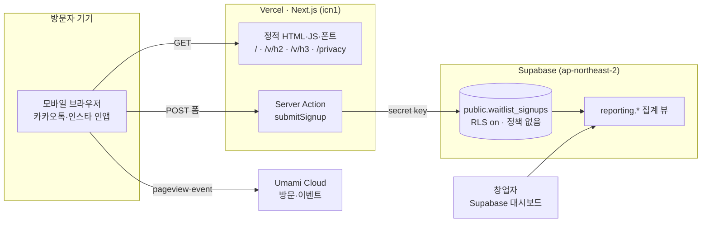
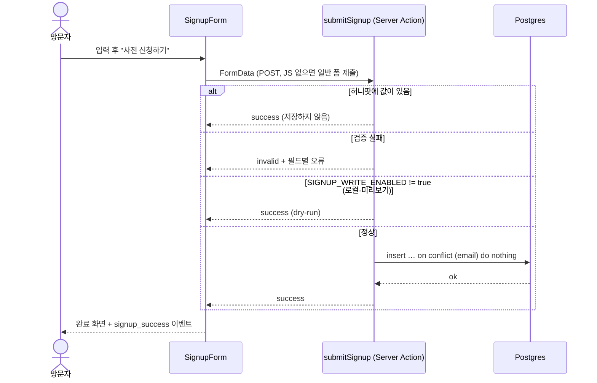

# Experii 랜딩페이지 기술 명세서 (TSD)

| 항목 | 내용 |
|---|---|
| 문서 | TSD · 랜딩페이지 v0.1 (초안) |
| 작성일 | 2026-10-26 |
| 기준 | [Experii_PRD_v0.1.md](Experii_PRD_v0.1.md) 10장(랜딩페이지 요구사항). 카피 근거는 1·3·5·6·7·11장 |
| 표기 | **(확인 필요)** = 구현 전에 공식 문서·법률 검토로 다시 확인할 항목. 17.3에 모아 두었다. `[제안]` = PRD에 없어 이 문서가 정한 초안 |
| 결정 | 2026-10-26 D1~D3 확정 (17.1) |

## 0. 요약

- **목적**: USP를 검증하고 초기 사용자를 모은다. 1차 지표는 사전 신청 수다(PRD 10장 `[제안]`). 목표 숫자는 Q5(운영 계획)에서 정한다.
- **형태**: 한 페이지(`/`), 서비스 가이드(`/docs/[slug]`), 개인정보 처리방침(`/privacy`). 가이드는 랜딩에 다 담지 못한 설명을 맡고, 페이지마다 사전 신청으로 돌아가는 길을 둔다. 모바일과 카카오톡 인앱 브라우저를 기본 환경으로 둔다.
- **스택**: Next.js App Router(정적 생성) on Vercel, 신청 저장은 Supabase Postgres, 방문 분석은 쿠키를 쓰지 않는 Umami Cloud. [TSD_MVP_V1.md](../TSD_MVP_V1.md)와 같은 계열이지만 코드와 DB는 따로 둔다.
- **신청**: Server Action 하나. 이메일, 질문 3개(신분·SQLD 상태·유료 AI 구독), 필수 동의를 받는다. 유입 경로(UTM)와 본 히어로 문구를 같은 행에 남긴다.
- **카피 원칙**: 모든 문구를 `content/` 한곳에 모으고, PRD 7장의 금지 표현을 테스트로 막는다. AI 연동은 "Experii 앱에 내 ChatGPT 계정을 등록한다"로만 쓰고 Claude 연동은 약속하지 않는다(D1). 출시 전 기능은 출시 예정임을 밝힌다.

## 1. 범위

### 1.1 포함

- PRD 10장의 7개 섹션과 푸터
- 핵심 루프 4단계 인터랙션(학습 대화 → 현장 과제 → 경험 카드 → 1·7·30일 리마인드)
- 사전 신청 폼, 신청 저장, 개인정보 처리방침 페이지
- UTM·이벤트 수집, 창업자용 집계 뷰(SQL)
- 검색·공유 메타데이터(OG, 카카오톡 미리보기)
- 서비스 가이드(`/docs/[slug]`): 헤더 메뉴 `가이드`로 들어가는 정적 문서 페이지. 왼쪽 목차, 본문, 오른쪽 "이 페이지에서"의 3단 구성(2026-10-29 창업자 결정)

### 1.2 제외

| 제외 | 이유 |
|---|---|
| 회원가입·로그인, 실제 앱 기능 | 랜딩은 출시 전 소개 페이지다 |
| ChatGPT 계정 등록 실연 | 제품 기능이고, OpenAI 파트너 승인 전이다(17.3 C10) |
| 확인 메일·뉴스레터 발송 | PRD에 없음. 17.1 D5 |
| 관리자 화면 | 신청 수십~수백 건은 Supabase 대시보드와 집계 뷰로 충분하다 |
| 경쟁사 실명 비교표 | PRD 7장: 경쟁사를 깎아내리는 비교 문구를 쓰지 않는다 |
| 앱스토어 배지 | 앱이 아직 없다 |
| 다크 모드, 다국어, 블로그 | 1차 검증에 필요 없다. 채널(Q4)이 정해진 뒤 판단 |
| 가이드의 API·도구 메뉴 | 공개 API와 체험 도구는 PRD에 없다 |

### 1.3 다른 문서와의 관계

| 문서 | 제품 형태 | 이 문서와의 관계 |
|---|---|---|
| [PRD_MVP_V1.md](../PRD_MVP_V1.md) · [TSD_MVP_V1.md](../TSD_MVP_V1.md) | 웹 + 원격 MCP, Claude Code 중심, 세션 요약 누적 | 스택(Next.js·Vercel·Supabase)만 맞춘다. 기능은 가져오지 않는다 |
| [Pre_MVP/](../Pre_MVP/) prd·tsd·plan | Claude Code Skill, 로컬 파일 | 무관. 랜딩 일정은 Pre-MVP와 독립이다 |
| [Experii_PRD_v0.1.md](Experii_PRD_v0.1.md) | 모바일 앱, GPT·Claude 구독 연동, 면접 중심 학습 | 이 문서의 기준 |

**충돌**: 랜딩 PRD는 모바일 앱과 ChatGPT 연동을 내세운다. 기존 개발 문서는 Claude Code·웹 기준이고 모바일 앱과 ChatGPT를 범위 밖에 둔다. 랜딩은 아직 없는 제품을 소개하므로 화면은 모두 "예시 화면"으로 표시하고, 약속하는 기능은 6.3의 근거 표를 따른다. 제품 문서를 어떻게 맞출지는 랜딩과 별개로 정한다(17.1 D8).

**랜딩 PRD와 다른 점 (D1)**: 랜딩 PRD는 "GPT·Claude 연동"이라고 쓰지만 이 문서는 ChatGPT 계정 등록만 약속한다.
- Claude: Free·Pro·Max 구독 인증은 약관상 Claude Code와 claude.ai에서만 쓸 수 있다(2026-02 문서로 명시, 2026-04부터 기술적으로 차단). 그래서 Experii 앱 안에서 Claude 구독으로 대화하게 만들 수 없다(17.3 C11).
- ChatGPT: 2026-09-29에 나온 "Sign in with ChatGPT"로 Plus·Pro 사용량을 외부 앱에서 쓸 수 있다. 다만 상업 앱은 아직 선정된 파트너만 쓴다(17.3 C10).

랜딩 PRD의 F1과 서브 카피를 이에 맞춰 고칠지는 사용자가 정한다.

## 2. 설계 원칙

1. **측정이 목적이다.** 모든 신청 행에 어디서 왔는지(UTM)와 어떤 히어로 문구를 봤는지 함께 남긴다.
2. **근거 없는 약속을 하지 않는다.** 카피는 `content/` 한곳에만 둔다. 금지 표현은 테스트로 막고, 출시 전 기능은 출시 예정임을 밝힌다.
3. **모바일 인앱 브라우저가 기본이다.** 360px 폭, 카카오톡·인스타그램 인앱에서 먼저 확인한다.
4. **필요한 것만 받는다.** 이메일과 질문 3개 외에는 받지 않는다. IP·전화번호·이름은 저장하지 않는다.
5. **JS가 없어도 신청된다.** 폼은 일반 `<form>` 제출로 동작하고, JS는 오류 표시와 이벤트 전송만 보탠다.
6. **문구 수정이 컴포넌트를 건드리지 않는다.** 히어로 카피를 바꾸는 데 `content/` 한 파일이면 된다.

## 3. 아키텍처



| 구성 요소 | 역할 |
|---|---|
| 정적 페이지 | 빌드 때 HTML로 만든다. 히어로 변형도 각각 정적 페이지다 |
| `submitSignup` | 폼 검증, 허니팟 확인, 신청 저장. 페이지에서 유일한 서버 코드 |
| `waitlist_signups` | 신청 저장소. 외부(anon) 접근을 RLS로 모두 막고 서버만 쓴다 |
| `reporting` 스키마 | 일별·채널별·H3 집계 뷰. API에 노출하지 않는다 |
| Umami | 방문자·CTA 클릭·폼 시작·신청 완료 이벤트. 개인정보는 보내지 않는다 |

## 4. 기술 선택

| 영역 | 선택 | 이유 | 대안 |
|---|---|---|---|
| 프레임워크 | Next.js App Router, React 19, TypeScript. 버전은 구현 시점 최신 안정판으로 고정 **(확인 필요)** | TSD_MVP_V1과 같은 계열이라 나중에 제품 웹과 배포 방식을 공유한다. 정적 생성 + Server Action 하나로 별도 백엔드 없이 신청을 받는다 | Astro (더 가볍지만 스택이 하나 늘어난다) |
| 런타임 | Node.js 22 LTS 이상 | Node.js 20은 2026-04에 지원이 끝났다 | — |
| 호스팅 | Vercel | PR마다 미리보기 URL이 생겨 카피 검토가 쉽다. 서울 리전(icn1) 함수 | Cloudflare Pages |
| 스타일 | Tailwind CSS v4 + CSS 변수 토큰 | 토큰을 데모(`demo/experii-demo.html`) 팔레트에서 시작한다 | CSS Modules |
| 폰트 | Pretendard Variable 동적 서브셋, npm 패키지로 자체 호스팅 **(확인 필요)** | 한글 웹폰트를 unicode-range 조각으로 나눠 필요한 글자만 받는다. 외부 CDN이 없어 CSP가 단순해진다 | 시스템 폰트만 |
| 신청 저장 | Supabase Postgres, 랜딩 전용 프로젝트, 서울 리전 | MVP와 같은 도구. 제약 조건·뷰·CSV 내보내기를 대시보드에서 바로 쓴다 | Tally 폼 임베드: 반나절이면 되지만 디자인, UTM·변형 연결, 데이터 위치 통제가 약하다 |
| 검증 | Zod 4 | MVP와 같다. 서버 검증 스키마를 테스트에서 그대로 쓴다 | Valibot |
| 분석 | Umami Cloud **(확인 필요: 무료 플랜 한도)** | 쿠키가 없어 동의 배너 없이 퍼널을 잰다. UTM 분해와 커스텀 이벤트를 지원한다 | GA4(무료·강력, 쿠키 사용과 처리방침 고지 필요), Vercel Web Analytics(커스텀 이벤트는 유료 플랜 **(확인 필요)**) |
| 스팸 방지 | 허니팟 + 이메일 유니크 + Vercel Firewall 요청 제한 | 비용과 사용자 마찰이 없다. 실제 스팸이 들어오면 Cloudflare Turnstile을 붙인다(P1) | hCaptcha |
| 테스트 | Vitest, Playwright + `@axe-core/playwright`, Lighthouse CI | 단위·E2E·접근성·성능 | — |

## 5. 디렉토리 구조

Vercel 프로젝트의 Root Directory를 `landing`으로 둔다. PRD 파일은 지금 위치에 그대로 둔다.

```
landing/
  Experii_PRD_v0.1.md          # 기준 PRD (기존)
  Experii_PRD_v0.1.pdf
  TSD.md                       # 이 문서
  package.json
  next.config.ts               # 보안 헤더
  app/
    layout.tsx                 # lang="ko", 폰트, 기본 메타데이터, 분석 스크립트
    page.tsx                   # 히어로 h1
    v/[variant]/page.tsx       # P1: h2·h3 정적 생성, canonical은 /
    privacy/page.tsx
    docs/layout.tsx            # 가이드 3단 레이아웃
    docs/[slug]/page.tsx       # 가이드 페이지 정적 생성
    actions/signup.ts          # Server Action
    api/cron/keepalive/route.ts  # Supabase 무료 플랜일 때만 (14.3)
    opengraph-image.png        # 1200×630
    robots.ts
    sitemap.ts
  components/
    sections/                  # Hero Problem Shift HowItWorks Difference EasyStart SignupSection Footer
    loop/                      # LoopStepper ChatMock TaskMock CardMock ReminderMock
    signup/                    # SignupForm ChoiceChips SignupSuccess
    ui/                        # PhoneFrame ExampleBadge StickyCta Button
  content/
    landing.ts                 # 섹션 카피, 히어로 변형, CTA 문구
    loop.ts                    # 루프 4단계 예시 데이터
    privacy.ts                 # 동의 문구, 처리방침 본문, CONSENT_VERSION
    docs.ts                    # 가이드 목차와 본문
  lib/
    signup-schema.ts           # Zod 스키마 (폼 값 → 행)
    attribution.ts             # UTM·referrer 수집
    analytics.ts               # track() 래퍼, 스크립트 없으면 no-op
    supabase-server.ts         # import 'server-only'
  supabase/
    migrations/0001_waitlist.sql
  tests/
    unit/                      # schema, attribution, content-guard
    integration/               # signup action + 로컬 Supabase, RLS
    e2e/                       # Playwright
```

`content/`를 세 파일로 나눈 것은 병렬 작업 때 파일이 겹치지 않게 하려는 것이다(16.2).

## 6. 페이지 구성

### 6.1 섹션 명세

| # | 앵커 | 컴포넌트 | 내용 (PRD 근거) | 구현 요점 |
|---|---|---|---|---|
| 1 | `#top` | `Hero` | 히어로 카피(변형 h1~h3), 서브 카피(6.3 표 1행), Before→After 대비. 면접관 "SQL 써 보셨어요?" → Before "자격증 있어요" → After "주문 없는 회원을 찾는 과제에서 LEFT JOIN으로 이렇게 써 봤어요" (1장, 10장) | 이미지 없이 텍스트와 말풍선으로 그린다. LCP 요소는 히어로 제목이다. 주 CTA "사전 신청하기" → `#signup` |
| 2 | `#problem` | `Problem` | 고객이 한 말 3개를 3장 원문 그대로: "AI와 공부하며 공부 시간은 늘어났는데 이해도는 떨어지는 느낌", "웹 리서치로 얻은 정보가 노션과 카톡에 누적만 되어 있고 실제로 다시 보지 않음", "웹 리서치 시간이 너무 아까움" | 인용 카드 3장. 출처는 "창업자와 주변 대학생"으로 사실대로 쓰고 숫자로 부풀리지 않는다 |
| 3 | `#shift` | `Shift` | 서류는 AI로 쉬워졌고, 이제 어려운 건 대화가 오가는 면접 (H1 가설) | 단정하지 않고 질문형으로 쓴다. 예: "서류는 AI가 도와줘요. 면접에서 나누는 대화는요?" 통계·수치를 쓰지 않는다 |
| 4 | `#how` | `HowItWorks` + `LoopStepper` | 핵심 루프 4단계 (6장, F2~F5) | 6.2 |
| 5 | `#difference` | `Difference` | 지원 직전이 아니라 공부하는 날마다. 몇 달 치 기록은 나중에 만들 수 없다 (5장 USP) | 가로 타임라인: 자격증 공부 → 지원 → 면접. "지원할 때 쓰는 도구"는 지원 시점부터, Experii는 공부 첫날부터 쌓인다. 경쟁사 실명을 쓰지 않는다 |
| 6 | `#start` | `EasyStart` | 가입 → Experii 앱에 내 ChatGPT 계정 등록 → 공부 시작. Experii 이용료 없음 (F1, 9장, D1) | 3단계 아이콘 행. 섹션 제목을 "출시하면 이렇게 시작해요"로 해 출시 전 기능임을 밝힌다. 문구는 6.3 근거 표를 따른다 |
| 7 | `#signup` | `SignupSection` | 사전 신청. SQLD 공부 중인 대학생 우선 안내 (10장) | 7장 |
| — | — | `Footer` | 문의 이메일, 처리방침 링크, "출시 전 제품이며 화면은 예시입니다" | — |
| — | — | `StickyCta` (P1) | 모바일 하단 고정 "사전 신청하기" | 히어로 CTA와 `#signup`이 둘 다 화면 밖일 때만 보인다(IntersectionObserver). `env(safe-area-inset-bottom)` 반영 |

### 6.2 작동 방식 인터랙션 (`LoopStepper`)

SQLD 공부 하나가 면접 답변이 되기까지를 한 이야기로 보여 준다. 4단계 모두 폰 프레임 안의 예시 화면이고, HTML/CSS로 그린다(이미지 아님).

| 단계 | 화면 | 예시 데이터 (`content/loop.ts`, 문구는 확정 전 초안) |
|---|---|---|
| ① 학습 대화 | Experii 앱 채팅 화면, 상단에 "ChatGPT 연결됨" 표시 | 사용자: "LEFT JOIN이랑 INNER JOIN 차이가 헷갈려" / AI: 차이를 예시 테이블 두 개로 설명 |
| ② 현장 과제 | 과제 카드 + 사용자 풀이 | "쇼핑몰 주문 테이블에서 가입 후 한 번도 주문하지 않은 회원을 찾아 마케팅팀에 넘겨 주세요" → `LEFT JOIN … WHERE o.id IS NULL` |
| ③ 경험 카드 | 카드 한 장 | 면접 답변 한 줄: "가입 후 주문이 없는 회원을 LEFT JOIN과 IS NULL로 추려 재방문 안내 대상 목록을 만드는 과제를 풀어 봤습니다." 태그 `SQLD` `JOIN`, 날짜 |
| ④ 리마인드 | 잠금화면 알림 3개 | 1일 뒤: 배운 점 / 7일 뒤: 활용 방안 / 30일 뒤: 면접 예상 질문과 예시 답변 (F5) |

- 경험 카드 예시에 세션에 없는 성과(매출 상승률 같은 수치)를 넣지 않는다. 지어낸 성과는 제품 원칙과도 맞지 않는다.
- **동작**: 탭 4개와 패널 하나. 사용자가 누를 때만 넘어가고 자동 진행은 하지 않는다(WCAG 2.2.2). P1에서 모바일 가로 스와이프를 더한다.
- **JS가 없을 때**: 4단계가 세로로 모두 보인다. 탭 UI는 hydration 뒤에 켜진다.
- **접근성**: `role="tablist"`·`tab`·`tabpanel`, 좌우 화살표 키 이동, `aria-selected`, `aria-controls`. `prefers-reduced-motion`이면 전환 애니메이션을 끈다.
- 모든 목업 위에 `ExampleBadge`("예시 화면")를 붙인다.
- 단계를 처음 열 때 `loop_step` 이벤트를 보낸다(9.2).

### 6.3 카피와 근거 관리

**규칙**

- 화면 문구는 `content/*.ts`에만 둔다. 컴포넌트에 한국어 문장을 직접 쓰지 않는다(코드 리뷰에서 확인).
- `tests/unit/content-guard.test.ts`가 `content/landing.ts`, `content/loop.ts`, `content/docs.ts`를 문자열로 펼쳐 금지 표현을 찾는다. 하나라도 있으면 CI가 실패한다. 처리방침(`content/privacy.ts`)은 "권리 보장" 같은 법정 문구가 들어가므로 검사에서 뺀다.

```ts
const BANNED = [
  '면접 준비 끝', '합격 보장', '확연한 차이', // PRD 7장
  '최고', '1위', '유일',                      // PRD 7장 단정·비교
  '보장', '무조건', '100%',                   // [제안] 성과 보장으로 읽히는 표현
];
```

**근거 표**: 공개 전에 이 표의 "공개 전 처리"를 모두 반영한다.

| 주장 | 섹션 | PRD 근거 | 근거 상태 | 공개 전 처리 |
|---|---|---|---|---|
| Experii 앱에 내 ChatGPT 계정을 등록한다 | 히어로 서브, 6 | F1, D1 | 공식 경로(Sign in with ChatGPT)는 있으나 상업 앱은 파트너 승인이 필요하다 (C10) | 서브 카피 확정안: "내 ChatGPT 계정을 Experii 앱에 등록하면, 이제 공부만 하세요. 면접 소재는 Experii가 쌓아 둡니다." 6번 섹션 제목으로 출시 전 기능임을 밝힌다. 승인이 막히면 이 행부터 바꾼다 |
| Claude 연동 | — | F1 | 약관상 불가 (1.3) | 랜딩에 쓰지 않는다. 폼의 구독 질문(H3)에서만 묻는다 |
| 추가 구독료 없음 | 6 | 9장 | Experii 이용료 정책은 정해졌다. 외부 앱에서 플랜 사용량을 쓸 수 있는 건 ChatGPT Plus·Pro뿐이다 | "Experii 이용료는 받지 않아요. AI는 내 ChatGPT 구독(Plus·Pro)으로 써요"처럼 조건을 같이 쓴다 |
| 3분이면 준비 끝 | 히어로 서브, 6 | F1 목표치 | 측정 전 | 숫자를 쓰지 않는다 |
| 1·7·30일 리마인드 | 4 | F5 | 설계 단계 | 예시 배지와 "출시 예정 기능" 표기 |
| 경험 카드로 이력서·면접 답변 작성 | 4, 5 | F6 | 설계 단계 | 언급하면 예정으로 표기 |
| 고객 인용 3개 | 2 | 3장 | 창업자와 친구 2명 | 출처를 사실대로. "많은 대학생이" 같은 일반화 금지 |
| 서류는 쉬워졌고 면접이 어렵다 | 3 | H1 | `[가설]` | 질문형. 통계 인용 금지 |
| 지원 직전이 아니라 공부하는 날마다 | 5 | 5장 USP | 제품 설계상 사실 | 경쟁사 실명 없이 |

출시 전 제품을 소개하는 광고 표기 기준은 법률 검토가 필요하다 **(확인 필요)**.

### 6.4 히어로 변형 (P1)

PRD 10장의 히어로 카피 후보 3개를 채널별 링크로 나눠 반응을 본다.

| 변형 | 경로 | 히어로 카피 |
|---|---|---|
| `h1` | `/` | 공부하는 오늘이, 면접에서 말할 경험이 됩니다 |
| `h2` | `/v/h2` | "자격증 있어요" 대신 "이렇게 써 봤어요" |
| `h3` | `/v/h3` | 자격증 공부하면서 면접 답변도 같이 쌓으세요 |

- `generateStaticParams`로 `h2`·`h3`를 정적 생성한다. 히어로 외 섹션은 같다.
- 변형 페이지는 `canonical`을 `/`로, `robots`를 `noindex`로 둔다.
- 변형 id를 폼 hidden 필드(`hero_variant`)와 모든 분석 이벤트 속성에 넣는다.
- 무작위 배정은 하지 않는다. 배정하려면 쿠키나 동적 렌더링이 필요한데, 초기 트래픽으로는 통계적 결론이 나지 않는다. 표본이 작을 때는 방향만 참고한다.

## 7. 사전 신청

### 7.1 폼 필드

| 필드 | UI | 필수 | 값 | 목적 (PRD) |
|---|---|---|---|---|
| `email` | `type="email"` `autocomplete="email"` `inputmode="email"` | 예 | 254자 이하, 앞뒤 공백 제거, 소문자 | 출시·시범 사용 안내 |
| `student_status` | 라디오 칩 | 예 | `undergrad` 대학생 · `job_seeker` 졸업 후 취업 준비 · `other` 기타 | 타깃 적합도 (4장) |
| `sqld_status` | 라디오 칩 | 예 | `studying` 지금 공부 중 · `planning` 공부할 계획 · `certified` 이미 취득 · `none` 해당 없음 | 우선 대상 선정 (10장 CTA) |
| `ai_subscriptions` | 체크 칩(복수) | 1개 이상 | `chatgpt_paid` ChatGPT 유료 · `claude_paid` Claude 유료 · `none` 유료 구독 없음 | H3 구독 보유율 (11장) |
| `consent` | 체크박스 | 예 | `on` | 개인정보 수집·이용 동의 (7.2) |
| `website` | 허니팟. 화면 밖, `tabindex="-1"`, `autocomplete="off"`, `aria-hidden` | 비어 있어야 함 | — | 봇 차단 |
| `hero_variant` | hidden. 서버가 렌더할 때 채운다 | — | `h1`·`h2`·`h3` | 메시지별 전환 |
| `utm_*`, `referrer_host` | hidden. `attribution.ts`가 채운다 | — | 9.1 | 채널별 신청 |

- 라디오·체크 칩은 실제 `<input>`을 꾸민 것이다. 그룹마다 `<fieldset>`과 `<legend>`를 쓴다.
- `none`을 고르면 다른 구독 선택이 풀리고, 반대도 같다(JS). 서버도 같은 규칙으로 검증한다.
- 폼 위에 "SQLD를 공부 중인 대학생께 먼저 연락드려요"를 둔다.

### 7.2 동의 문구 (초안, 법률 검토 필요)

```
[필수] 개인정보 수집·이용 동의
· 수집 항목: 이메일, 신분, SQLD 공부 상태, 유료 AI 구독 여부
· 이용 목적: Experii 출시·시범 사용 안내, 서비스 기획을 위한 응답 집계
· 보유 기간: 수집일로부터 1년 또는 철회 요청 시 즉시 파기
· 동의하지 않을 수 있으며, 동의하지 않으면 사전 신청이 되지 않습니다.
만 14세 이상이며 위 내용에 동의합니다.
```

- `CONSENT_VERSION`(예: `privacy-2026-10-26`)을 `content/privacy.ts`에 두고 신청 행에 같이 저장한다. 문구를 바꾸면 버전을 올린다.
- `/privacy` 처리방침에 담을 것: 처리 목적, 항목, 보유·파기, 제3자 제공 없음, 처리 위탁(Vercel 호스팅, Supabase 저장, Umami 분석), 국외 이전 해당 여부, 철회 방법, 개인정보 보호책임자(창업자 본인, 실명)와 연락처(`hello@experii.app`). 문의와 철회 요청도 같은 주소로 받는다(D3).
- 위탁·국외 이전 고지 범위, 만 14세 확인 방식, 출시 안내 메일이 광고성 정보에 해당하는지는 법률 확인이 필요하다 **(확인 필요)**. 출시 안내 외에 마케팅 메일을 보내려면 별도 동의를 받아야 하므로 지금 폼에는 넣지 않는다.

### 7.3 처리 흐름



- **중복 이메일**: 새 신청과 같은 성공 응답을 준다. 이미 신청했는지 드러내지 않고, 처음 행을 그대로 둔다.
- **DB 오류**: "잠시 후 다시 시도해 주세요"를 보여 주고, 서버 로그에는 오류 코드만 남긴다(이메일을 남기지 않는다).
- **완료 화면**: "신청됐어요. 출시와 시범 사용 소식을 이메일로 알려 드릴게요." 입력한 이메일을 다시 보여 줄 때는 React 텍스트 노드로만 그린다.
- **철회**: `hello@experii.app`으로 요청을 받고, 창업자가 8.3의 SQL로 지운다.

### 7.4 구현 스케치

```ts
// lib/signup-schema.ts
export const SignupSchema = z.object({
  email: z.string().trim().toLowerCase().max(254).pipe(z.email()),
  studentStatus: z.enum(['undergrad', 'job_seeker', 'other']),
  sqldStatus: z.enum(['studying', 'planning', 'certified', 'none']),
  aiSubscriptions: z
    .array(z.enum(['chatgpt_paid', 'claude_paid', 'none']))
    .min(1)
    .max(2)
    .refine((v) => !v.includes('none') || v.length === 1),
  consent: z.literal('on'),
  heroVariant: z.enum(['h1', 'h2', 'h3']).catch('h1'),
  attribution: AttributionSchema, // utm 5종 + referrerHost, 각 100~255자에서 자름
});

// app/actions/signup.ts
'use server';
export async function submitSignup(_prev: SignupState, formData: FormData): Promise<SignupState> {
  if (formData.get('website')) return { status: 'success' };
  const parsed = SignupSchema.safeParse(fromFormData(formData));
  if (!parsed.success) return { status: 'invalid', fieldErrors: toFieldErrors(parsed.error) };
  if (process.env.SIGNUP_WRITE_ENABLED !== 'true') return { status: 'success' };
  const { error } = await supabaseServer()
    .from('waitlist_signups')
    .upsert(toRow(parsed.data), { onConflict: 'email', ignoreDuplicates: true });
  if (error) {
    console.error('signup_insert_failed', error.code);
    return { status: 'error' };
  }
  return { status: 'success' };
}
```

오류 문구:

| 필드 | 문구 |
|---|---|
| `email` | 이메일 주소를 확인해 주세요 |
| `student_status` | 지금 상황을 골라 주세요 |
| `sqld_status` | SQLD 공부 상태를 골라 주세요 |
| `ai_subscriptions` | 하나 이상 골라 주세요 |
| `consent` | 동의해야 신청할 수 있어요 |
| 서버 오류 | 잠시 후 다시 시도해 주세요 |

JS가 켜져 있으면 제출 실패 때 첫 오류 필드로 포커스를 옮긴다.

## 8. 데이터 모델

### 8.1 마이그레이션 `supabase/migrations/0001_waitlist.sql`

```sql
create extension if not exists citext;

create table public.waitlist_signups (
  id               uuid primary key default gen_random_uuid(),
  email            citext not null unique check (char_length(email) <= 254),
  student_status   text not null check (student_status in ('undergrad', 'job_seeker', 'other')),
  sqld_status      text not null check (sqld_status in ('studying', 'planning', 'certified', 'none')),
  ai_subscriptions text[] not null check (
    cardinality(ai_subscriptions) between 1 and 2
    and ai_subscriptions <@ array['chatgpt_paid', 'claude_paid', 'none']::text[]
    and (not ('none' = any(ai_subscriptions)) or cardinality(ai_subscriptions) = 1)
  ),
  consent_version  text not null check (char_length(consent_version) <= 40),
  hero_variant     text not null default 'h1' check (hero_variant in ('h1', 'h2', 'h3')),
  utm_source       text check (char_length(utm_source) <= 100),
  utm_medium       text check (char_length(utm_medium) <= 100),
  utm_campaign     text check (char_length(utm_campaign) <= 100),
  utm_content      text check (char_length(utm_content) <= 100),
  utm_term         text check (char_length(utm_term) <= 100),
  referrer_host    text check (char_length(referrer_host) <= 255),
  created_at       timestamptz not null default now()
);

-- 정책을 만들지 않는다: anon·authenticated는 읽기·쓰기 모두 막히고, 서버는 secret key로만 쓴다
alter table public.waitlist_signups enable row level security;
revoke all on public.waitlist_signups from anon, authenticated;
```

- 동의 시각은 `created_at`과 같으므로 따로 두지 않는다.
- 앱 검증(Zod)과 DB 제약을 둘 다 둔다. 한쪽이 뚫려도 다른 쪽이 막는다.

### 8.2 집계 뷰

Supabase는 `public` 스키마의 뷰를 API로 노출하고, 뷰는 기본으로 소유자 권한으로 실행돼 RLS를 건너뛴다. 그래서 집계 뷰는 API에 노출하지 않는 `reporting` 스키마에 둔다. 창업자는 대시보드 SQL 편집기에서 읽는다.

```sql
create schema if not exists reporting;
revoke all on schema reporting from anon, authenticated;

create view reporting.signups_daily as
select (created_at at time zone 'Asia/Seoul')::date as day,
       coalesce(utm_source, '(direct)')             as source,
       hero_variant,
       count(*)                                     as signups
from public.waitlist_signups
group by 1, 2, 3;

create view reporting.h3_subscriptions as
select count(*) as total,
       count(*) filter (where ai_subscriptions && array['chatgpt_paid', 'claude_paid']::text[]) as paid_any,
       count(*) filter (where 'chatgpt_paid' = any(ai_subscriptions))                          as chatgpt_paid,
       count(*) filter (where 'claude_paid'  = any(ai_subscriptions))                          as claude_paid,
       count(*) filter (where ai_subscriptions = array['none']::text[])                        as no_paid
from public.waitlist_signups;

create view reporting.priority_targets as
select email, created_at
from public.waitlist_signups
where student_status = 'undergrad' and sqld_status = 'studying'
order by created_at;
```

### 8.3 운영 SQL

```sql
-- 철회 요청
delete from public.waitlist_signups where email = '<요청 이메일>';

-- 보유 기간 만료 (월 1회, 수동)
delete from public.waitlist_signups where created_at < now() - interval '1 year';
```

CSV가 필요하면 대시보드 테이블 화면에서 내보낸다.

## 9. 유입 추적과 지표

### 9.1 UTM

- 첫 로드 때 URL의 `utm_source`·`utm_medium`·`utm_campaign`·`utm_content`·`utm_term`과 `document.referrer`의 호스트만 `sessionStorage`(`experii_attr`)에 저장한다. 같은 탭 안에서는 처음 값을 유지한다. 쿠키는 쓰지 않는다.
- 폼이 마운트되면 이 값을 hidden 필드에 채운다. JS가 없으면 비어 있는 채로 저장된다.
- 각 값은 100자(referrer 호스트는 255자)에서 자른다. 저장한 값은 화면에 다시 그리지 않는다.
- 카카오톡·인스타그램 인앱 브라우저는 referrer를 거의 넘기지 않는다. 채널을 구분하는 근거는 사실상 UTM뿐이므로 **배포하는 모든 링크에 UTM을 붙인다.**
- 명명 규칙은 Q5에서 정한다. 그때까지의 예시 `[제안]`: `utm_source=instagram|kakao|everytime`, `utm_medium=social|community|dm`, `utm_campaign=waitlist-2026-11`, `utm_content`=게시물 id.

### 9.2 이벤트

| 이벤트 | 시점 | 속성 |
|---|---|---|
| pageview (자동) | 페이지 로드 | 경로, referrer, UTM (Umami가 수집) |
| `cta_click` | CTA 버튼 클릭 | `location`: `hero` · `easy_start` · `sticky`, `variant` |
| `loop_step` | 루프 단계를 처음 열 때 | `step`: 1~4, `variant` |
| `form_start` | 폼 필드에 처음 입력할 때 | `variant` |
| `signup_success` | 서버가 success를 돌려줬을 때 | `variant`, `sqld_status` |
| `signup_error` | invalid 또는 error | `kind`: `validation` · `server` |

- `lib/analytics.ts`의 `track(name, data)`는 `window.umami`가 없으면(광고 차단, 로컬, 미리보기) 아무것도 하지 않는다.
- 이벤트 속성에 이메일이나 자유 입력값을 넣지 않는다.
- 분석 스크립트는 `NEXT_PUBLIC_UMAMI_WEBSITE_ID`가 있을 때만 넣는다. production에서만 설정한다.

### 9.3 지표 정의

| 지표 | 정의 | 출처 | 목표 |
|---|---|---|---|
| **사전 신청 수 (1차)** | `waitlist_signups` 행 수 | DB | Q5에서 확정 |
| 방문자 | 고유 방문자 | Umami | 관찰 |
| 신청 전환율 | 신청 수 / 고유 방문자 | DB + Umami | Q5에서 확정 |
| 폼 완료율 | `signup_success` / `form_start` | Umami | 관찰 |
| 채널별 신청 | `utm_source`별 행 수 | `reporting.signups_daily` | 관찰 |
| 메시지별 전환 (P1) | 변형별 신청 / 변형별 방문 | DB + Umami | 관찰 |
| 유료 AI 구독 보유율 (H3) | 유료 구독 1개 이상 / 신청 수 | `reporting.h3_subscriptions` | 판정 기준은 사용자 결정 |
| 우선 대상 비율 | 대학생이면서 SQLD 공부 중 / 신청 수 | `reporting.priority_targets` | 관찰 |

광고 차단기를 쓰는 방문자는 Umami에 잡히지 않아 방문자가 실제보다 적게 나온다. 그만큼 전환율은 높게 보이므로 참고 지표로만 쓰고, 판단은 DB의 신청 수로 한다.

## 10. 검색·공유

- `app/layout.tsx`의 `metadata`: `title` "Experii · 공부하는 오늘이, 면접에서 말할 경험이 됩니다", `description`은 서브 카피, `metadataBase`는 `NEXT_PUBLIC_SITE_URL`. `<html lang="ko">`.
- OG: `app/opengraph-image.png`(1200×630, 히어로 문구와 로고), `og:locale` `ko_KR`, `twitter:card` `summary_large_image`.
- 카카오톡은 OG 태그로 링크 미리보기를 만들고 결과를 캐시한다. OG 문구나 이미지를 바꾸면 카카오 개발자 사이트의 공유 디버거로 캐시를 지운다 **(확인 필요: 도구 위치)**.
- `robots.ts`: production만 색인을 허용하고, 로컬·미리보기는 `noindex`. `sitemap.ts`: `/`, `/docs/*`, `/privacy`.
- 네이버 서치어드바이저 사이트 등록(P1). 소유 확인 메타 태그는 환경 변수로 넣는다.

## 11. 디자인·반응형·접근성

- **기준 폭**: 360px부터 설계한다. 중단점은 640px·1024px, 콘텐츠 최대 폭은 1080px.
- **토큰**: `demo/experii-demo.html` 팔레트에서 시작한다. 배경 `#f7f6f2`, 글자 `#1d1d1b`, 강조 `#2f6f5e`, 사용자 말풍선 `#3d5a99`, 경험 카드 `#9a5b13`. 브랜드가 정해지기 전 임시값이다. 라이트 테마 하나로 간다(`color-scheme: light`).
- **한글 타이포**: 본문 16px·행간 1.65. 히어로는 모바일 28~32px, 데스크톱 48~56px. 본문과 제목에 `word-break: keep-all`을 걸어 단어 중간에서 줄이 바뀌지 않게 하고, 제목에는 `text-wrap: balance`를 쓴다.
- **폰 목업**: CSS로 그린 프레임. 래스터 이미지를 쓰지 않는다.
- **접근성 (WCAG 2.2 AA)**: 본문 대비 4.5:1 이상, 모든 입력에 `<label>`, 오류는 `aria-invalid`와 `aria-describedby`, 눈에 보이는 포커스 링, 터치 영역 44px 이상, `prefers-reduced-motion` 존중.
- **인앱 브라우저**: 높이는 `100vh` 대신 `100svh`·`100dvh`를 쓴다. 하단 고정 요소는 safe-area 여백을 둔다. 키보드가 올라올 때 이메일 입력이 가려지지 않는지 실기기에서 본다.

## 12. 성능 예산

모바일, Lighthouse 모바일 기본 조건 기준.

| 항목 | 목표 |
|---|---|
| LCP | 2.5초 이하 (히어로 제목) |
| CLS | 0.05 이하 (폰트 교체 때 밀림 포함) |
| INP | 200ms 이하 |
| 첫 로드 JS (gzip) | 150KB 이하. 클라이언트 컴포넌트는 `LoopStepper`·`SignupForm`·`StickyCta`·attribution만 |
| 이미지 | OG 이미지 외 래스터 이미지 없음 |
| Lighthouse | Performance 90 · Accessibility 95 · Best Practices 95 · SEO 95 이상 |

애니메이션 라이브러리는 넣지 않는다. 전환은 CSS transition으로 한다.

가이드 페이지는 서버 컴포넌트만 쓴다. 모바일 목차는 `<details>`로 접어 JS 없이 동작한다.

## 13. 보안·개인정보

| 위협 | 대응 |
|---|---|
| 신청 데이터 유출 | RLS를 켜고 정책을 두지 않는다. `anon`·`authenticated` 권한 회수. secret key는 `lib/supabase-server.ts`(`import 'server-only'`)에서만 읽고 `NEXT_PUBLIC_` 접두사를 붙이지 않는다. 집계 뷰는 API 비노출 스키마에 둔다 |
| 봇 대량 신청 | 허니팟, 이메일 유니크, Vercel Firewall에서 POST 요청 제한 **(확인 필요: 플랜 조건)**. 스팸이 들어오면 Turnstile(P1) |
| 이메일 존재 여부 노출 | 중복 신청도 같은 성공 응답 |
| XSS | 사용자 입력을 HTML로 다시 그리지 않는다. `dangerouslySetInnerHTML` 금지. CSP |
| CSRF | Server Action의 Origin 검사(Next.js 기본). 커스텀 도메인을 프록시 뒤에 두면 `serverActions.allowedOrigins` 설정 |
| 로그로 새는 개인정보 | 서버 로그에는 오류 코드만. 이메일·응답값을 남기지 않는다 |
| 분석 도구로 새는 개인정보 | 이벤트 속성에 개인정보 금지(9.2) |
| 데이터 위치 | Supabase 서울 리전(`ap-northeast-2`), Vercel 함수 리전 `icn1`. 그래도 국외 사업자 위탁이므로 처리방침에 적는다 **(확인 필요)** |

`next.config.ts`의 응답 헤더:

```
Content-Security-Policy:
  default-src 'self';
  script-src 'self' 'unsafe-inline' https://cloud.umami.is;
  style-src 'self' 'unsafe-inline';
  font-src 'self';
  img-src 'self' data:;
  connect-src 'self' <Umami 수집 엔드포인트>;
  frame-ancestors 'none'; form-action 'self'; base-uri 'self'
X-Content-Type-Options: nosniff
Referrer-Policy: strict-origin-when-cross-origin
Permissions-Policy: camera=(), microphone=(), geolocation=()
```

정적 생성 페이지는 요청마다 nonce를 만들 수 없어 Next.js 인라인 스크립트를 위해 `'unsafe-inline'`을 허용한다. 사용자 입력을 다시 그리지 않는 페이지라 이 정도로 둔다. Umami 스크립트·수집 도메인은 구현 때 확인해 채운다 **(확인 필요)**.

## 14. 환경·배포

### 14.1 환경

| 환경 | 브랜치 | 주소 | 신청 저장 | 분석 | 색인 |
|---|---|---|---|---|---|
| 로컬 | — | `localhost:3000` | 로컬 Supabase(`supabase start`) | 끔 | 막음 |
| 미리보기 | PR 브랜치 | `*.vercel.app` | dry-run (저장 안 함) | 끔 | 막음 |
| 운영 | `main` | `experii.app` (D2) | 운영 Supabase 프로젝트 | 켬 | 허용 |

미리보기에서 저장하지 않으므로 운영 신청 수에 테스트 신청이 섞이지 않고, Supabase 클라우드 프로젝트도 하나면 된다.

### 14.2 환경 변수

| 이름 | 노출 | 설명 |
|---|---|---|
| `SUPABASE_URL` | 서버 | 프로젝트 URL |
| `SUPABASE_SECRET_KEY` | 서버 전용 | secret key (이전 이름 service_role) **(확인 필요: 현재 키 체계)** |
| `SIGNUP_WRITE_ENABLED` | 서버 | `true`일 때만 DB에 쓴다. 운영에서만 `true` |
| `NEXT_PUBLIC_SITE_URL` | 공개 | canonical·OG 절대 URL |
| `NEXT_PUBLIC_UMAMI_WEBSITE_ID` | 공개 | 운영에서만 설정 |
| `CRON_SECRET` | 서버 | 14.3 keepalive를 쓸 때만 |

### 14.3 Vercel·Supabase 설정

- Vercel: Root Directory `landing`, Framework Next.js, 함수 리전 `icn1`, Node.js 22 이상.
- Vercel Hobby 플랜은 비상업 용도로 제한된다. 사전 신청을 받는 스타트업 랜딩이 여기에 해당하는지 확인하고, 해당하면 Pro로 간다 **(확인 필요)**.
- Supabase 무료 프로젝트는 일정 기간 요청이 없으면 일시 정지된다 **(확인 필요: 현재 기준)**. 신청이 뜸한 시기에 폼이 실패하지 않도록, 무료 플랜이면 Vercel Cron이 하루 한 번 `GET /api/cron/keepalive`(`Authorization: Bearer $CRON_SECRET` 확인 후 `select 1` 수준의 조회)를 부른다. 유료 플랜이면 이 경로를 만들지 않는다.

### 14.4 공개 전 체크리스트

- [ ] 6.3 근거 표의 "공개 전 처리"를 모두 반영
- [ ] 처리방침·동의 문구 확정, `CONSENT_VERSION` 갱신
- [ ] `experii.app` 구매·연결, HTTPS, `NEXT_PUBLIC_SITE_URL`
- [ ] `hello@experii.app` 수신 설정. 등록 기관의 메일 포워딩이나 Cloudflare Email Routing으로 창업자 메일에 전달한다 **(확인 필요)**
- [ ] OpenAI Sign in with ChatGPT 상업 파트너 관심 신청서 제출 (C10)
- [ ] `supabase db push`로 마이그레이션 적용, anon key로 select·insert가 거부되는지 확인
- [ ] Umami 사이트 등록, 운영 도메인에서 pageview 확인
- [ ] 카카오톡에 링크를 붙여 OG 미리보기 확인
- [ ] 운영에서 실제 신청 1건 → 행 확인 → 삭제

## 15. 테스트·검증

### 15.1 자동

| 종류 | 도구 | 확인할 것 |
|---|---|---|
| 단위 | Vitest | `signup-schema`: 정상 입력, 필드별 오류, `none` 배타 규칙, 이메일 정규화. `attribution`: UTM 파싱, 길이 자르기, 값 없음. `content-guard`: 금지 표현 0건. `analytics`: 스크립트 없을 때 no-op |
| 서버 액션 | Vitest + 로컬 Supabase | 새 신청 저장, 중복 이메일이 같은 응답에 행 1개, 허니팟은 저장 안 함, dry-run은 저장 안 함, DB 오류 때 일반 문구 |
| DB 권한 | Supabase CLI + 테스트 스크립트 | anon key로 `waitlist_signups` select·insert 거부, `reporting` 접근 거부, check 제약 위반 거부 |
| E2E | Playwright (360×780 모바일, 1280×800 데스크톱) | 히어로 CTA → `#signup` 이동, 루프 탭 키보드 이동, 신청 성공 화면, 필수 누락 오류와 포커스 이동, UTM 붙은 URL로 신청하면 행에 UTM 저장, `javaScriptEnabled: false`에서 신청 성공 |
| 접근성 | `@axe-core/playwright` | serious·critical 위반 0 |
| 성능 | Lighthouse CI (미리보기 URL) | 12장 예산 |

### 15.2 실제 브라우저 확인

CLAUDE.md 규칙대로 실제 브라우저에서 확인한 뒤 완료를 보고한다.

| 환경 | 확인할 것 |
|---|---|
| iOS Safari, Android Chrome | 폰트 로딩, `keep-all` 줄바꿈, 루프 탭, 신청 완료 |
| 카카오톡 인앱 (iOS·Android) | 위 항목 + 하단 고정 CTA safe-area, 키보드가 올라올 때 입력 가림, OG 미리보기 |
| 인스타그램 인앱 | 신청 완료, UTM 저장 |
| Windows Chrome·Edge, macOS Safari | 데스크톱 레이아웃, 포커스 링 |

## 16. 구현 순서

### 16.1 단계

| 단계 | 내용 | 완료 조건 |
|---|---|---|
| L0 결정 | 17.1의 D1~D3 (2026-10-26 확정) | 이 문서에는 반영했다. `content/`에는 L1에서 넣는다 |
| L1 골격 | Next.js 생성, 토큰·폰트, `content/landing.ts`, 정적 섹션 1·2·3·5·6과 푸터, `content-guard` 테스트 | `npm run build` 성공, `content-guard` 통과, 360px 스크린샷 |
| L2 루프 | `LoopStepper`와 목업 4개, `content/loop.ts` | 키보드 E2E 통과, JS를 끄면 4단계가 세로로 보임 |
| L3 신청 | 마이그레이션, Server Action, 폼, `/privacy`, `content/privacy.ts` | 서버 액션·DB 권한 테스트 통과, 로컬에서 신청한 행 확인 |
| L4 측정·공유 | attribution, Umami, 이벤트 연결, OG, robots·sitemap, (P1) 히어로 변형 | UTM E2E 통과, 미리보기에서 OG 확인 |
| L5 QA·공개 | 15.2 실기기 확인, Lighthouse, 14.4 체크리스트 | 12장 예산 충족, 실기기 확인 기록 |

### 16.2 병렬로 나눌 때

L1이 끝난 뒤 아래 셋은 파일이 겹치지 않아 `.agents/briefs/`로 동시에 돌릴 수 있다. 브리프의 목표 칸에는 이 문서의 단계 번호를 적는다.

| 브리프 | 건드리는 파일 |
|---|---|
| `landing-loop` | `components/loop/**`, `content/loop.ts` |
| `landing-signup` | `app/actions/**`, `components/signup/**`, `lib/signup-schema.ts`, `lib/supabase-server.ts`, `supabase/**`, `app/privacy/**`, `content/privacy.ts` |
| `landing-measure` | `lib/attribution.ts`, `lib/analytics.ts`, `app/robots.ts`, `app/sitemap.ts`, `app/opengraph-image.png` |

`app/page.tsx` 조립과 이벤트 연결(`cta_click` 등 섹션 컴포넌트 수정)은 병합 뒤 한 세션에서 한다.

## 17. 열린 결정·리스크·확인 필요

### 17.1 열린 결정

| # | 결정 | 권장 · 확정 |
|---|---|---|
| D1 | 연동을 랜딩에 어떤 문장으로 쓸지 | **확정 (2026-10-26)**: "Experii 앱에 내 ChatGPT 계정을 등록할 수 있다"로 쓴다. ASIDE처럼 앱 안에서 계정을 연결하는 방식이다. Claude 연동은 쓰지 않는다. 6.3 표에 반영 |
| D2 | 도메인 | **확정**: `experii.app` (사용자 선호 없음 → 권장안). 구매는 사용자가 한다. `experii.com`은 2014년부터 다른 소유자가 있고 `experi.com`으로 넘어간다 |
| D3 | 신청 데이터 보유 기간, 개인정보 보호책임자 표기 | **확정**: 수집일로부터 1년 또는 철회 시 파기. 책임자는 창업자 본인(실명), 연락처는 `hello@experii.app` |
| D4 | 폼에 H1 질문("서류와 면접 중 어디가 더 막막한가요?")이나 4주 시범 사용 참여 의향을 더할지 | 더하지 않는다. 필드가 늘면 이탈이 는다. 시범 사용자 모집 때 따로 묻는다 |
| D5 | 확인 메일(더블 옵트인) | 넣지 않는다. 오타·가짜 이메일이 신청 수에 섞이는 한계를 감수한다 |
| D6 | 분석 도구 | Umami Cloud |
| D7 | 히어로 변형(6.4) 운영 | Q4에서 채널이 정해지면 켠다 |
| D8 | 제품 개발 문서(PRD_MVP_V1, Pre_MVP)와 랜딩 PRD의 제품 형태 차이(모바일 앱·ChatGPT 연동) 정리 | 랜딩 공개와 별개로 결정 |

### 17.2 리스크

| 리스크 | 영향 | 대응 |
|---|---|---|
| OpenAI가 Sign in with ChatGPT 파트너로 승인하지 않거나 승인이 늦어짐 | "ChatGPT 계정 등록·이용료 없음" 약속을 출시 때 못 지켜 신청자 신뢰가 떨어진다 | 랜딩을 공개할 때 관심 신청서를 함께 낸다. 문구가 한 파일에 있어 바로 바꾸고, 신청자에게 변경을 안내한다 |
| 출시 전 기능 소개가 과장 광고로 읽힘 | 신뢰·법적 위험 | 예시 배지, 금지 표현 테스트, "출시 예정" 표기 |
| 인앱 브라우저가 referrer를 넘기지 않음 | 채널 판단 불가 | 모든 링크에 UTM (Q5 규칙) |
| 광고 차단기로 방문자 과소 집계 | 전환율이 높게 보임 | 판단은 DB 신청 수로 |
| Supabase 무료 프로젝트 일시 정지 | 신청 실패 | keepalive cron 또는 유료 플랜 (14.3) |
| 트래픽이 적어 신청이 거의 없음 | 메시지 검증 불가 | 랜딩만의 문제가 아니다. Q4 채널 운영과 묶어 판단한다 |
| 스팸 | 지표 오염 | 허니팟 → Turnstile |

### 17.3 확인 필요

| # | 항목 | 위치 |
|---|---|---|
| C1 | Next.js 최신 안정판 버전, 정적 페이지 + Server Action 동작 | 4 |
| C2 | Umami Cloud 무료 플랜 한도, 이벤트 API, 스크립트·수집 도메인(CSP) | 4, 9, 13 |
| C3 | Vercel Hobby 약관의 상업적 이용 범위, Firewall 요청 제한 플랜 조건, `icn1` 리전 | 4, 13, 14 |
| C4 | Supabase 무료 플랜 일시 정지 기준, 서울 리전, 현재 API 키 체계 | 8, 14 |
| C5 | 동의 문구, 처리 위탁·국외 이전 고지, 만 14세 확인 방식 | 7.2, 13 |
| C6 | 출시 안내 메일이 광고성 정보 전송 규정에 해당하는지 | 7.2 |
| C7 | 카카오 공유 디버거 위치와 캐시 초기화 방법 | 10 |
| C8 | Pretendard npm 패키지의 동적 서브셋 CSS를 Next.js 빌드로 자체 호스팅할 수 있는지 | 4, 13 |
| C9 | 출시 전 제품을 소개할 때 표시·광고 기준 | 6.3 |
| C10 | Sign in with ChatGPT 상업 파트너 신청 조건과 심사 기간, 플랜 사용량 대상(Plus·Pro). 2026-10-26 기준 보도와 OpenAI 문서 요약으로만 확인했다 | 1.3, 6.3, 14.4 |
| C11 | Claude 구독 인증의 외부 앱 사용 금지 범위. 보도 기사로만 확인했으므로 Anthropic 약관·Claude Code 법무 문서 원문으로 다시 본다 | 1.3, 6.3 |
